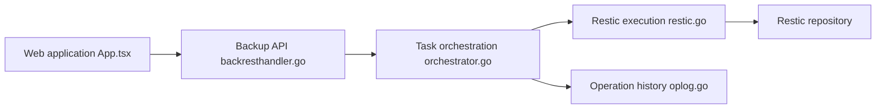

# garethgeorge/backrest

> Web interface for restic: schedule backups, browse snapshots and restore.

## The problem
restic is reliable but command-line only; scheduling, monitoring and restoring require scripting.

## What it actually does
A Go binary serves a WebUI (port 9898) that drives restic: repository creation, cron plans for backup and maintenance (prune, check, forget), pre/post hooks, notifications (Discord, Slack, Gotify, Healthchecks…). Supports all restic and rclone backends. Downloads restic on first launch.

## How it is wired


## Trying it
```bash
curl -fsSL https://raw.githubusercontent.com/garethgeorge/backrest/main/install.sh | bash
```
Then open `http://localhost:9898`.

## Cost and gotchas
Free; backup storage is at your expense. Opening `BACKREST_PORT` on all interfaces exposes the UI. Re-read `install.sh` before piping it into a shell.

## What it is not
Not a backup engine: it wraps restic. 365 open issues.

## Alternatives
No alternative named in the README (restic directly).

## For you
Keep an eye on it: handy for backing up a homelab or a data NAS, with no direct data/AI stake.
