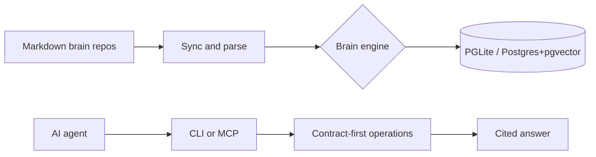

# garrytan/gbrain

> Explicit, sourced memory for AI agents, self-hostable, accessible via CLI or MCP.

## The problem
Agents forget from one session to the next, and their memory is locked inside each tool.

## What it actually does
Stores facts with their sources in a Markdown "brain" indexed by PGLite (default) or Postgres with pgvector. Search by keywords, semantic search, typed graph and optional cited synthesis. Installs through the Bun CLI and plugs into Claude Code, Codex and others via MCP. The README mentions an enrichment cron and connectors (Gmail, Slack, voice).

## How it is wired


## Trying it
```bash
bun install -g github:garrytan/gbrain#latest-stable
gbrain setup claude-code              # or: gbrain setup codex
gbrain init --pglite --no-embedding
gbrain import ~/notes/ --no-embed
gbrain search "a phrase from a note" --json
gbrain doctor
```

## Cost and gotchas
A keyless mode is possible; embeddings, synthesis and enrichment require third-party keys. Always on: 8 GB+ of RAM recommended. Never install via npm: the `gbrain` npm package is unrelated.

## What it is not
Not a full backup: the Markdown export does not include everything. Isolation of a shared brain is not universally guaranteed, the README says. The hosted gbrain.io is paid. README is truncated at the end of the document.

## Alternatives
None named as a repository in the README.

## For you
Watch: a relevant memory layer for agents, but a very wide surface and the author's figures are unverified; test in keyless mode before going further.
