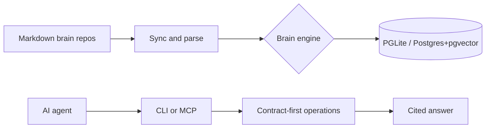

# garrytan/gbrain

> Mémoire explicite et sourcée pour agents IA, auto-hébergeable, accessible par CLI ou MCP.

## Le problème
Les agents oublient d'une session à l'autre, et leur mémoire est enfermée dans chaque outil.

## Ce que ça fait vraiment
Stocke des faits avec leurs sources dans un « brain » Markdown indexé par PGLite (par défaut) ou Postgres avec pgvector. Recherche par mots-clés, sémantique, graphe typé et synthèse citée optionnelle. S'installe par CLI Bun et se branche à Claude Code, Codex et autres via MCP. Le README mentionne cron d'enrichissement et connecteurs (Gmail, Slack, voix).

## Comment c'est branché


## Essayer
```bash
bun install -g github:garrytan/gbrain#latest-stable
gbrain setup claude-code              # or: gbrain setup codex
gbrain init --pglite --no-embedding
gbrain import ~/notes/ --no-embed
gbrain search "a phrase from a note" --json
gbrain doctor
```

## Coût et pièges
Mode sans clé possible ; embeddings, synthèse et enrichissement demandent des clés tierces. Toujours actif : 8 Go+ de RAM conseillés. Ne jamais installer via npm : le paquet npm `gbrain` est étranger.

## Ce que ce n'est pas
Pas une sauvegarde complète : l'export Markdown n'inclut pas tout. L'isolation d'un brain partagé n'est pas garantie universellement, dit le README. L'hébergé gbrain.io est payant. README tronqué en fin de document.

## Alternatives
Aucune nommée en dépôt dans le README.

## Pour toi
À surveiller : couche de mémoire pertinente pour agents, mais surface très large et chiffres de l'auteur non vérifiés ; tester en mode sans clé avant d'aller plus loin.

