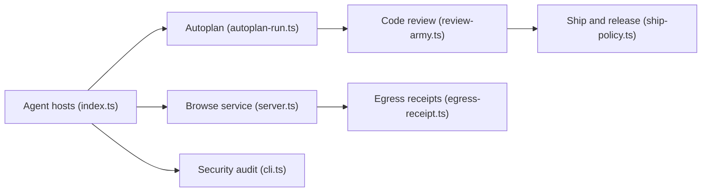

# garrytan/gstack

> A collection of slash commands that transform Claude Code into a virtual team, from product thinking to deployment.

## The problem
A developer working alone with a client lacks structure: there is no defined product scope, no code review, no real quality assurance, and no repeatable delivery process.

## What it actually does
Around 30 skills are being developed using Markdown: /office-hours, /plan-ceo-review, /plan-eng-review, /review, /qa (real browser), /cso (security audit), /ship, /land-and-deploy. This includes a controllable browser, standalone tools (model benchmarking, egress register), and an optional GBrain memory. Support for Claude Code (complete) and several other agents is also being provided.

## How it is wired


## Trying it
```bash
git clone --single-branch --depth 1 https://github.com/garrytan/gstack.git ~/.claude/skills/gstack && cd ~/.claude/skills/gstack && ./setup
cd ~/gstack && ./setup --host auto
~/.claude/skills/gstack/bin/gstack-uninstall
```

## Cost and gotchas
Bun is required, Docker for the complete /cso, external reviews via Codex (excluding one account) sending diffs and code. Telemetry is opt-in, but a default update check contacts GitHub, and a Stop hook is registered. The productivity figures (810×) are the author's self-assessment.

## What it is not
Not just a prompt: binaries and hooks are installed in ~/.claude. Not an independent equivalent of the agent: only "Claude Code" is "full". The author uses a personal argument.

## Alternatives
- Superpowers: A lighter approach focused on planning and Test-Driven Development (TDD).
- Agent-browser (vercel-labs): A command-line browser that is useful if all you need is web control.

## For you
Things to watch out for: Very powerful for structuring a solo project, but its reliance on the system (hooks, external calls) requires careful evaluation before implementation.
