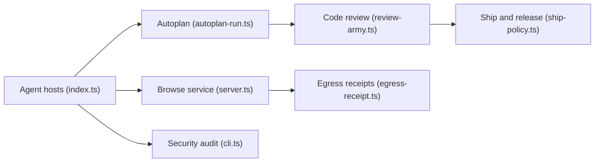

# garrytan/gstack

> Collection de slash commands qui transforme Claude Code en équipe virtuelle, de la réflexion produit à la mise en production.

## Le problème
Un développeur seul avec un agent manque de structure : pas de cadrage produit, de revue, de QA réel ni de processus de livraison reproductible.

## Ce que ça fait vraiment
Une trentaine de skills en Markdown suivent un sprint : /office-hours, /plan-ceo-review, /plan-eng-review, /review, /qa (navigateur réel), /cso (audit sécurité), /ship, /land-and-deploy. S'y ajoutent un navigateur pilotable, des outils autonomes (benchmark de modèles, registre d'egress), une mémoire GBrain optionnelle. Support de Claude Code (complet) et de plusieurs autres agents en expérimental.

## Comment c'est branché


## Essayer
```bash
git clone --single-branch --depth 1 https://github.com/garrytan/gstack.git ~/.claude/skills/gstack && cd ~/.claude/skills/gstack && ./setup
cd ~/gstack && ./setup --host auto
~/.claude/skills/gstack/bin/gstack-uninstall
```

## Coût et pièges
Bun requis, Docker pour /cso complet, revues externes via Codex (compte à part) envoyant diff et code. La télémétrie est opt-in, mais une vérification de mise à jour contacte GitHub par défaut, et un hook Stop est enregistré. Les chiffres de productivité (810×) sont l'auto-évaluation de l'auteur.

## Ce que ce n'est pas
Pas un simple prompt : des binaires et hooks s'installent dans ~/.claude. Pas un équivalent indépendant de l'agent : seul Claude Code est « full ». L'auteur utilise un argumentaire personnel marqué.

## Alternatives
- Superpowers : méthode plus légère centrée sur plan et TDD.
- Agent-browser (vercel-labs) : navigateur CLI si seul le pilotage web compte.

## Pour toi
À surveiller : très riche pour structurer un développement solo, mais l'emprise sur la machine (hooks, envois externes) demande un audit avant de l'adopter.

