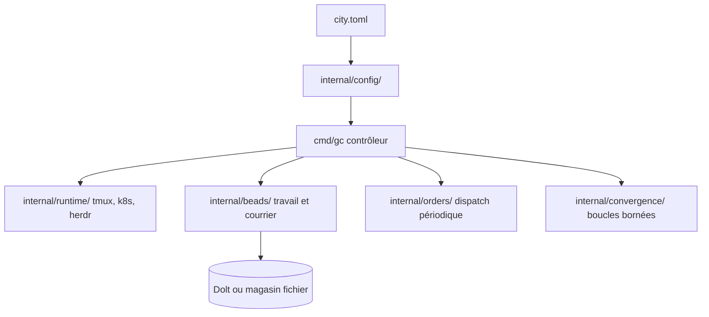

# gastownhall/gascity

> Declarative toolkit for orchestrating several coding agents across one or more repositories.

## The problem
Making several agents work together means hand-rolling sessions, task tracking and supervision loops.
Nothing reconciles the desired state with what is actually running.

## What it actually does
The city is described in a `city.toml`: agents, rigs, packs, overrides, all composed and validated by `internal/config/`.
Six runtime providers to choose from: tmux, subprocess, exec, ACP, Kubernetes and herdr — tmux remaining the mandatory fallback.
Work tracking goes through "beads" (work, mail, convoys) with two implementations: `bd` backed by Dolt by default, or a file store via `GC_BEADS=file`.
A controller/supervisor loop reconciles the desired state with the current state; `internal/convergence/` handles bounded refinement loops.

## How it is wired


## Trying it
```bash
brew install gascity
gc version
gc init ~/bright-lights
cd ~/bright-lights
gc start
gc rig add .
bd create "Create a script that prints hello world"
gc session attach mayor
```

## Cost and gotchas
The list of prerequisites is long: tmux, git, jq, pgrep, lsof always; dolt 2.1.0+, bd and flock if the beads provider is `bd`.
Building from source requires Go 1.26.4+ and ICU; on NixOS or Flox you have to point the three `CGO_*` variables by hand.
Dolt versions older than 1.86.2 can block `dolt_backup sync` under heavy write load.

## What it is not
Not Gas Town: it is the reusable infrastructure extracted from Gas Town, with a primitives-based model that is not ported literally.
Not an agent: you must supply `claude`, `codex` or `gemini` depending on the chosen provider.
Not a surprise-free install: the README devotes an entire section to broken CGO paths.

## Alternatives
- Gas Town: the upstream project, if you want the full architecture rather than the primitives.

## For you
Interesting if you really want to run several agents in parallel; the installation cost is high for occasional use.
