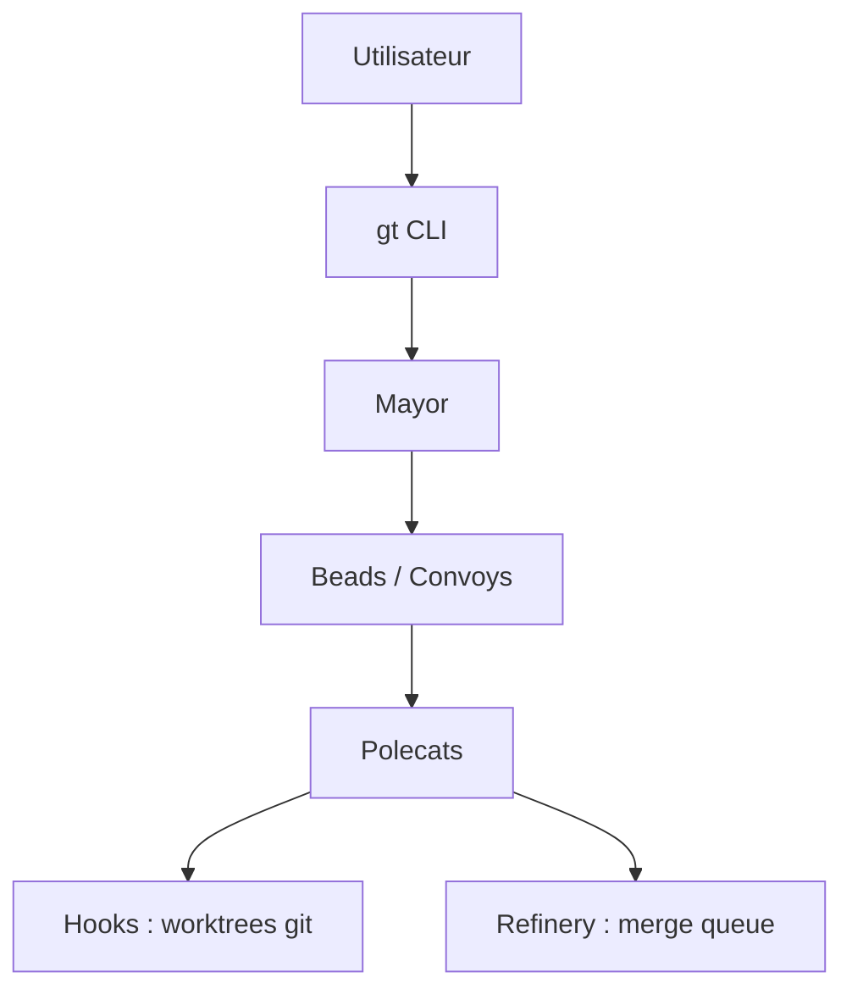

# gastownhall/gastown

> Orchestrator for multiple coding agents (Claude Code, Copilot, Codex, Gemini) with persistent state in git.

## The problem
Beyond a few agents, context is lost at every restart and manual coordination becomes chaotic.

## What it actually does
A "Mayor" (coordinator agent) splits the work into tickets ("beads" from the Beads ledger), groups them into convoys and distributes them to "polecats" (ephemeral agents with persistent identity). State lives in git worktrees ("hooks"). A Bors-style merge queue (Refinery) validates then merges; Witness, Deacon and Dogs monitor health, and a scheduler limits concurrency to avoid API quotas. Web dashboard, `gt feed` TUI, optional OpenTelemetry telemetry, federated Wasteland network via DoltHub.

## How it is wired


## Trying it
```bash
brew install gastown
gt install ~/gt --shell --git
cd ~/gt
gt up
gt doctor --fix
gt mayor attach
```

## Cost and gotchas
Requires Git 2.20+, Go, Beads (`bd`), Dolt, tmux and an agent CLI with a subscription or key; token consumption can climb with 20 to 30 agents. The dashboard must stay on a trusted local network.

## What it is not
It is not an agent: it coordinates third-party agents. The vocabulary (Mayor, Deacon, Seance...) is home-grown and requires a glossary.

## Alternatives
The README names none.

## For you
Worth watching: interesting for understanding persistent multi-agent orchestration, but complex and token-hungry for daily use.
