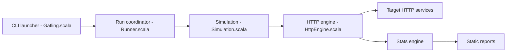

# gatling/gatling

> Load-testing tool in code (Java, Kotlin, Scala, JS/TS) for developers and CI teams.

## The problem
Measuring how a service holds up under load requires reproducible, versioned scenarios that can run in CI.

## What it actually does
You write simulations and run them locally or in CI via Maven, Gradle, sbt, npm plugins. Non-blocking engine (Netty), HTTP/1.1, HTTP/2, WebSocket, SSE, JMS; open or closed load models; HTML report with percentiles and assertions that fail the build. gRPC, MQTT, GraphQL are limited to 5 users / 5 minutes in the community edition.

## How it is wired


## Trying it
```bash
./mvnw gatling:test
```
(after placing the Java simulation in `src/test/java/example/` of the starter Maven project).

## Cost and gotchas
Community edition is free; Enterprise is paid (14-day trial). The AI extensions require an Enterprise API token.

## What it is not
Not a production monitoring tool; gRPC/MQTT/GraphQL protocols are capped without a license.

## Alternatives
JMeter and LoadRunner are mentioned (script conversion), without detailed comparison.

## For you
Adopt it to validate the load of an inference API or a data platform; tests in code, HTML reports, CI.
