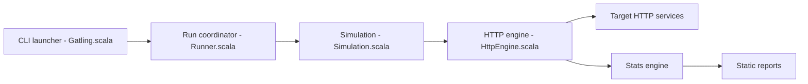

# gatling/gatling

> Outil de test de charge en code (Java, Kotlin, Scala, JS/TS) pour développeurs et équipes CI.

## Le problème
Mesurer la tenue en charge d'un service demande des scénarios reproductibles, versionnés et exécutables en CI.

## Ce que ça fait vraiment
Tu écris des simulations, les exécutes en local ou en CI via plugins Maven, Gradle, sbt, npm. Moteur non bloquant (Netty), HTTP/1.1, HTTP/2, WebSocket, SSE, JMS ; modèles de charge ouverts ou fermés ; rapport HTML avec percentiles et assertions qui font échouer le build. gRPC, MQTT, GraphQL sont limités à 5 utilisateurs / 5 minutes dans l'édition communautaire.

## Comment c'est branché


## Essayer
```bash
./mvnw gatling:test
```
(après avoir placé la simulation Java dans `src/test/java/example/` du projet Maven de démarrage).

## Coût et pièges
Édition communautaire gratuite ; Enterprise payante (14 jours d'essai). Les extensions IA exigent un jeton d'API Enterprise.

## Ce que ce n'est pas
Pas un outil de monitoring en production ; protocoles gRPC/MQTT/GraphQL plafonnés sans licence.

## Alternatives
JMeter et LoadRunner sont cités (conversion de scripts), sans comparaison détaillée.

## Pour toi
À adopter pour valider la charge d'une API d'inférence ou d'une plateforme de données ; tests en code, rapports HTML, CI.

