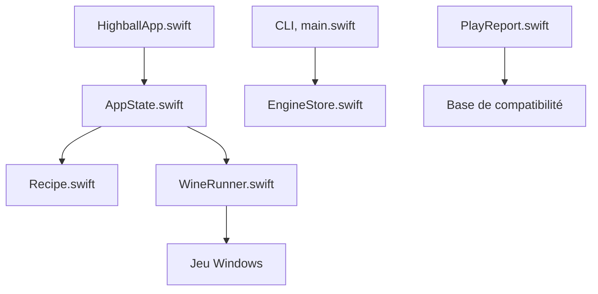

# gauthierpiarrette/highball

> macOS application that installs Wine and rendering engines to run Windows games.

## The problem
Running a Windows game on an Apple Silicon Mac requires assembling Wine, DXMT, D3DMetal and DXVK, without knowing what works.

## What it actually does
Highball installs a Wine engine and creates "bottles" with JSON recipes (installer, registry, winetricks, rendering engine). It connects Steam, Epic (via Legendary) and GOG, and picks the renderer per game from an open (CC0) compatibility database with provenance. A CLI performs the same operations; D3DMetal requires accepting Apple's licence.

## How it is wired


## Trying it
```bash
brew install --cask highball
git clone https://github.com/gauthierpiarrette/highball && cd highball
swift build -c release
.build/release/highball bottle create play --recipe steam
.build/release/highball run play Steam
```

## Cost and gotchas
Free, with no paid offer announced. Apple Silicon and macOS 14+ required; first installation takes 15 to 25 minutes under Rosetta. Beta version. GPL-3.0 licence.

## What it is not
It is not a commercially supported product: the README points to CrossOver for that. Games with kernel anti-cheat are flagged as impossible.

## Alternatives
CrossOver, cited as a paid, supported option.

## For you
Ignore: gaming on Mac, unrelated to data or MLOps; only the CC0 database is an example of open data.
