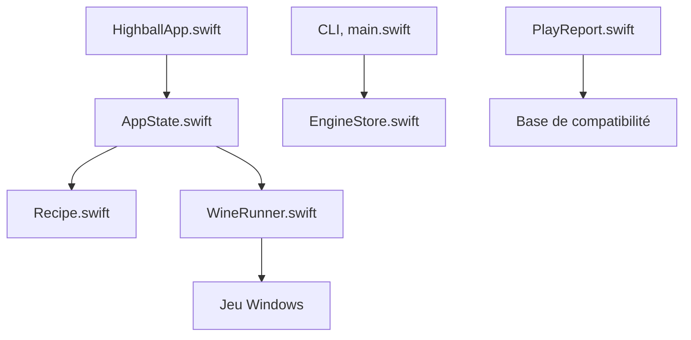

# gauthierpiarrette/highball

> Application macOS qui installe Wine et les moteurs de rendu pour faire tourner des jeux Windows.

## Le problème
Lancer un jeu Windows sur Mac Apple Silicon exige d'assembler Wine, DXMT, D3DMetal et DXVK, sans savoir ce qui fonctionne.

## Ce que ça fait vraiment
Highball installe un moteur Wine et crée des « bottles » avec des recettes JSON (installateur, registre, winetricks, moteur de rendu). Il connecte Steam, Epic (via Legendary) et GOG, et choisit le rendu par jeu d'après une base de compatibilité ouverte (CC0) avec provenance. Une CLI fait les mêmes opérations ; D3DMetal requiert l'acceptation de la licence Apple.

## Comment c'est branché


## Essayer
```bash
brew install --cask highball
git clone https://github.com/gauthierpiarrette/highball && cd highball
swift build -c release
.build/release/highball bottle create play --recipe steam
.build/release/highball run play Steam
```

## Coût et pièges
Gratuit, sans offre payante annoncée. Apple Silicon et macOS 14+ requis ; première installation de 15 à 25 minutes sous Rosetta. Version bêta. Licence GPL-3.0.

## Ce que ce n'est pas
Ce n'est pas un produit supporté commercialement : le README renvoie vers CrossOver pour cela. Les jeux avec anticheat noyau sont signalés comme impossibles.

## Alternatives
CrossOver, cité comme option payante et supportée.

## Pour toi
À ignorer : jeu sur Mac, sans rapport avec la donnée ou le MLOps ; seule la base CC0 est un exemple de données ouvertes.

