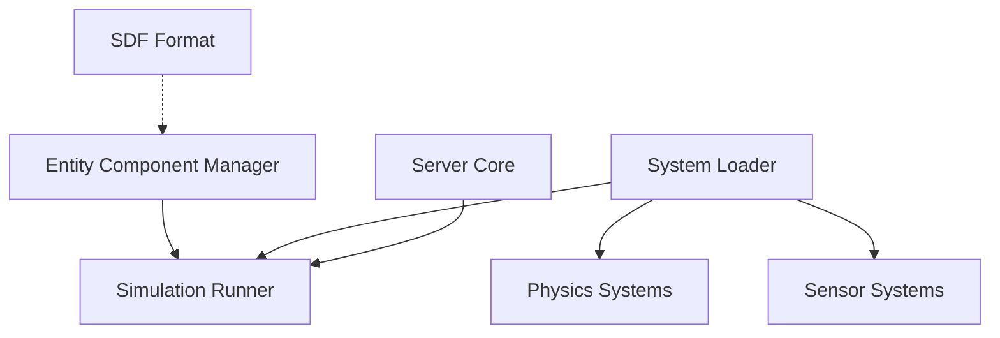

# gazebosim/gz-sim

> Open source robotics simulator with physics, 3D rendering and sensors, extensible through plugins.

## The problem
Validating a robot on hardware is costly; you need a realistic simulator of physics, sensors and environments.

## What it actually does
Runs worlds described in SDF, with several physics engines, 3D rendering (OGRE v2) and simulated sensors (lidar, cameras, IMU, GPS) with optional noise. The code is organized around an entity-component manager, a system loader and a simulation runner, with plugins. It offers a graphical interface, a `gz sim` CLI, Python bindings and a TCP/IP transport.

## How it is wired


## Trying it
```bash
gz sim
gz sim -h
gz sim -s
gz sim -g
```

## Cost and gotchas
Free. Installation goes through the official guide. On Windows, `gz sim` does not yet work in a single command: the server and the interface open in two terminals. Mixed Debian and source installations require `GZ_CONFIG_PATH`.

## What it is not
Not a ready-to-use reinforcement learning framework: it is the simulator alone. Nor is it a lightweight tool.

## Alternatives
No alternative named in the README.

## For you
Worth watching: the reference robotics simulator, useful if you train policies in simulation; otherwise outside your core work.
