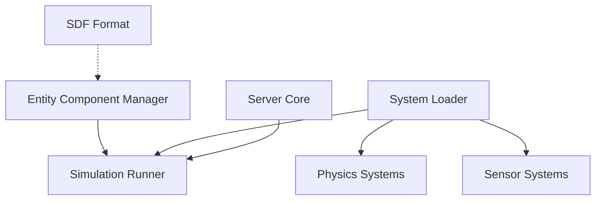

# gazebosim/gz-sim

> Simulateur robotique open source avec physique, rendu 3D et capteurs, extensible par plugins.

## Le problème
Valider un robot sur le matériel est coûteux ; il faut un simulateur réaliste de la physique, des capteurs et des environnements.

## Ce que ça fait vraiment
Fait tourner des mondes décrits en SDF, avec plusieurs moteurs physiques, un rendu 3D (OGRE v2) et des capteurs simulés (lidar, caméras, IMU, GPS) avec bruit optionnel. Le code s'organise autour d'un gestionnaire d'entités-composants, d'un chargeur de systèmes et d'un lanceur de simulation, avec plugins. Il propose une interface graphique, une CLI `gz sim`, des liens Python et un transport TCP/IP.

## Comment c'est branché


## Essayer
```bash
gz sim
gz sim -h
gz sim -s
gz sim -g
```

## Coût et pièges
Gratuit. L'installation passe par le guide officiel. Sous Windows, `gz sim` ne marche pas encore en une commande : serveur et interface s'ouvrent dans deux terminaux. Les installations mixtes Debian et source demandent `GZ_CONFIG_PATH`.

## Ce que ce n'est pas
Pas un cadre d'apprentissage par renforcement prêt à l'emploi : c'est le simulateur seul. Ce n'est pas non plus un outil léger.

## Alternatives
Aucune alternative nommée dans le README.

## Pour toi
À surveiller : référence du simulateur robotique, utile si tu entraînes des politiques en simulation ; sinon hors de ton cœur de métier.

