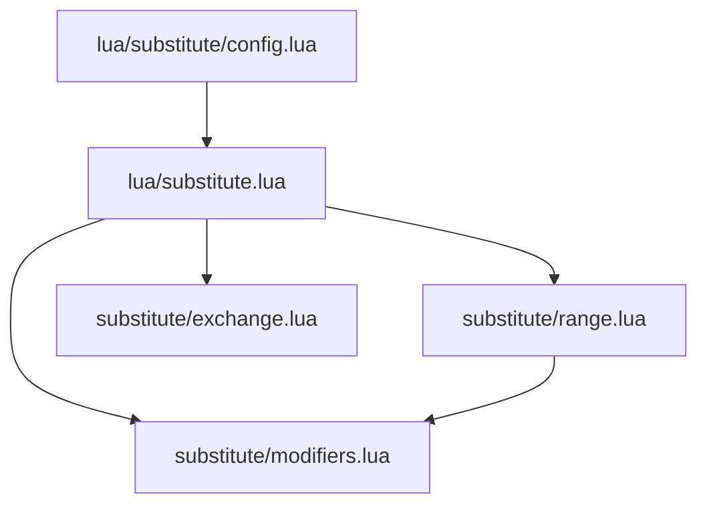

# gbprod/substitute.nvim

> Neovim operator plugin to quickly substitute, substitute over a range, and swap text.

## The problem
Replacing or swapping text in Vim requires heavy command chains.

## What it actually does
Provides a substitution operator using a register's content, a range substitution via two motions, and an exchange operator. Modifiers `linewise`, `reindent`, `trim`, `join`. No default key mappings. Lua rewrite of vim-subversive and vim-exchange.

## How it is wired


## Trying it
```bash
# Dans lazy.nvim :
# { "gbprod/substitute.nvim", opts = {} }
# require('substitute').setup()
```

## Cost and gotchas
Free. Neovim 0.8 or later. The suggested `s` mapping shadows the native command.

## What it is not
Not a refactoring engine: it operates on motions and registers, not on parsed code.

## Alternatives
- svermeulen/vim-subversive: original plugin it is a rewrite of.
- tommcdo/vim-exchange: original plugin for the exchange.

## For you
Neovim editing comfort, unrelated to data / AI: ignore.
