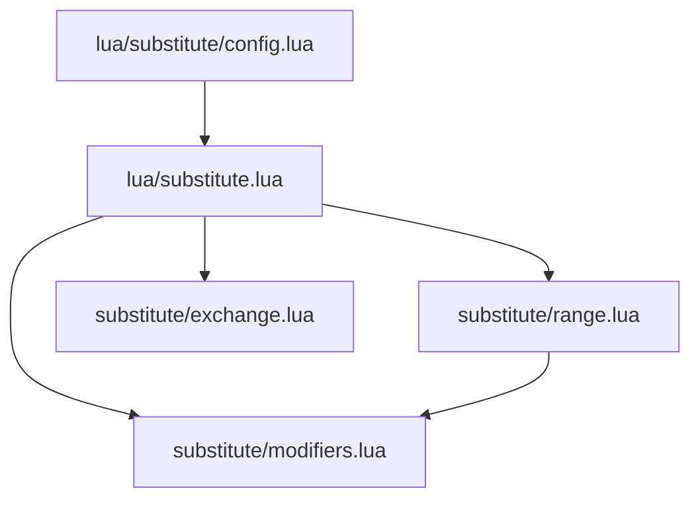

# gbprod/substitute.nvim

> Plugin Neovim d'opérateurs pour substituer, substituer sur une plage et échanger du texte rapidement.

## Le problème
Remplacer ou permuter du texte dans Vim demande des enchaînements de commandes lourds.

## Ce que ça fait vraiment
Fournit un opérateur de substitution par le contenu d'un registre, une substitution sur plage par deux mouvements, et un opérateur d'échange. Modificateurs `linewise`, `reindent`, `trim`, `join`. Aucun raccourci par défaut. Réécriture en Lua de vim-subversive et vim-exchange.

## Comment c'est branché


## Essayer
```bash
# Dans lazy.nvim :
# { "gbprod/substitute.nvim", opts = {} }
# require('substitute').setup()
```

## Coût et pièges
Gratuit. Neovim 0.8 ou plus. Le raccourci `s` proposé masque la commande native.

## Ce que ce n'est pas
Pas un moteur de refactoring : il opère sur des motions et registres, pas sur du code analysé.

## Alternatives
- svermeulen/vim-subversive : plugin d'origine dont il est la réécriture.
- tommcdo/vim-exchange : plugin d'origine pour l'échange.

## Pour toi
Confort d'édition Neovim, sans lien avec la data / IA : à ignorer.

