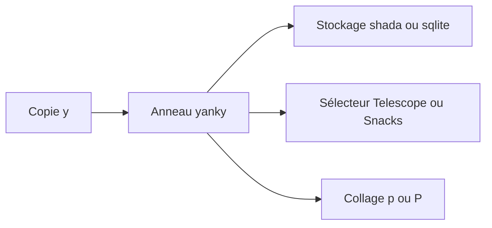

# gbprod/yanky.nvim

> Neovim plugin that improves copy-paste: copy history, highlighting and special pastes.

## The problem
Neovim keeps only one copy at a time and does not highlight it.

## What it actually does
- Yank ring (`yank ring`) browsable after a paste, 100 entries by default.
- History picker via `vim.ui.select`, Telescope or Snacks.
- Highlighting of yanked and pasted text; cursor preserved after a yank.
- Special pastes (linewise, indented, filtered) and a text object for the last paste.
- Storage in `shada`, `sqlite` or memory.
- No default keymap: you have to define them.

## How it is wired


## Trying it
```lua
{
  "gbprod/yanky.nvim",
  opts = {},
}
vim.keymap.set({"n","x"}, "p", "<Plug>(YankyPutAfter)")
```

## Cost and gotchas
Free. Neovim above 0.9.0. `sqlite.lua` required for sqlite storage.

## What it is not
Not a system clipboard manager. No effect without keymaps.

## Alternatives
Source of inspiration: svermeulen/vim-yoink, nvim-miniyank, vim-yankstack, vim-easyclip.

## For you
Ignore unless Neovim is your editor: editing comfort, no data / AI impact.
