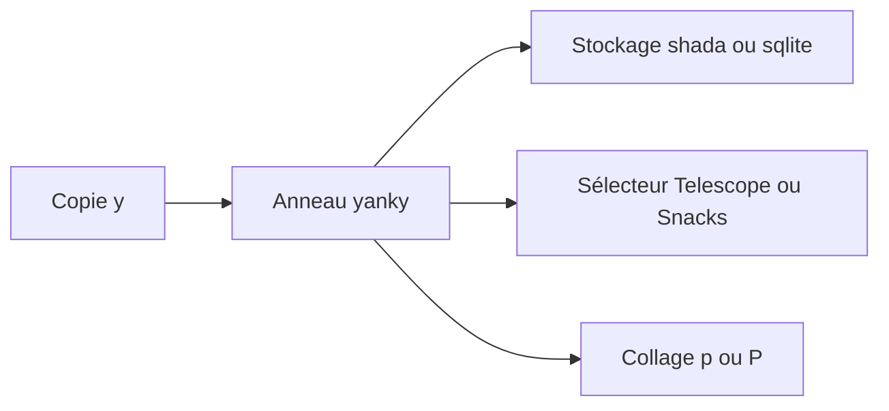

# gbprod/yanky.nvim

> Plugin Neovim qui améliore le copier-coller : historique des copies, surbrillance et collages spéciaux.

## Le problème
Neovim ne garde qu'une copie à la fois et ne la met pas en évidence.

## Ce que ça fait vraiment
- Anneau de copies (`yank ring`) parcourable après un collage, 100 entrées par défaut.
- Sélecteur d'historique via `vim.ui.select`, Telescope ou Snacks.
- Surbrillance des textes copiés et collés ; curseur préservé après copie.
- Collages spéciaux (linéaire, indenté, filtré) et objet texte du dernier collage.
- Stockage `shada`, `sqlite` ou mémoire.
- Aucun raccourci par défaut : il faut les définir.

## Comment c'est branché


## Essayer
```lua
{
  "gbprod/yanky.nvim",
  opts = {},
}
vim.keymap.set({"n","x"}, "p", "<Plug>(YankyPutAfter)")
```

## Coût et pièges
Gratuit. Neovim supérieur à 0.9.0. `sqlite.lua` requis pour le stockage sqlite.

## Ce que ce n'est pas
Pas un gestionnaire de presse-papiers système. Aucun effet sans raccourcis.

## Alternatives
Source d'inspiration : svermeulen/vim-yoink, nvim-miniyank, vim-yankstack, vim-easyclip.

## Pour toi
À ignorer sauf si Neovim est ton éditeur : confort d'édition, pas d'impact data / IA.

