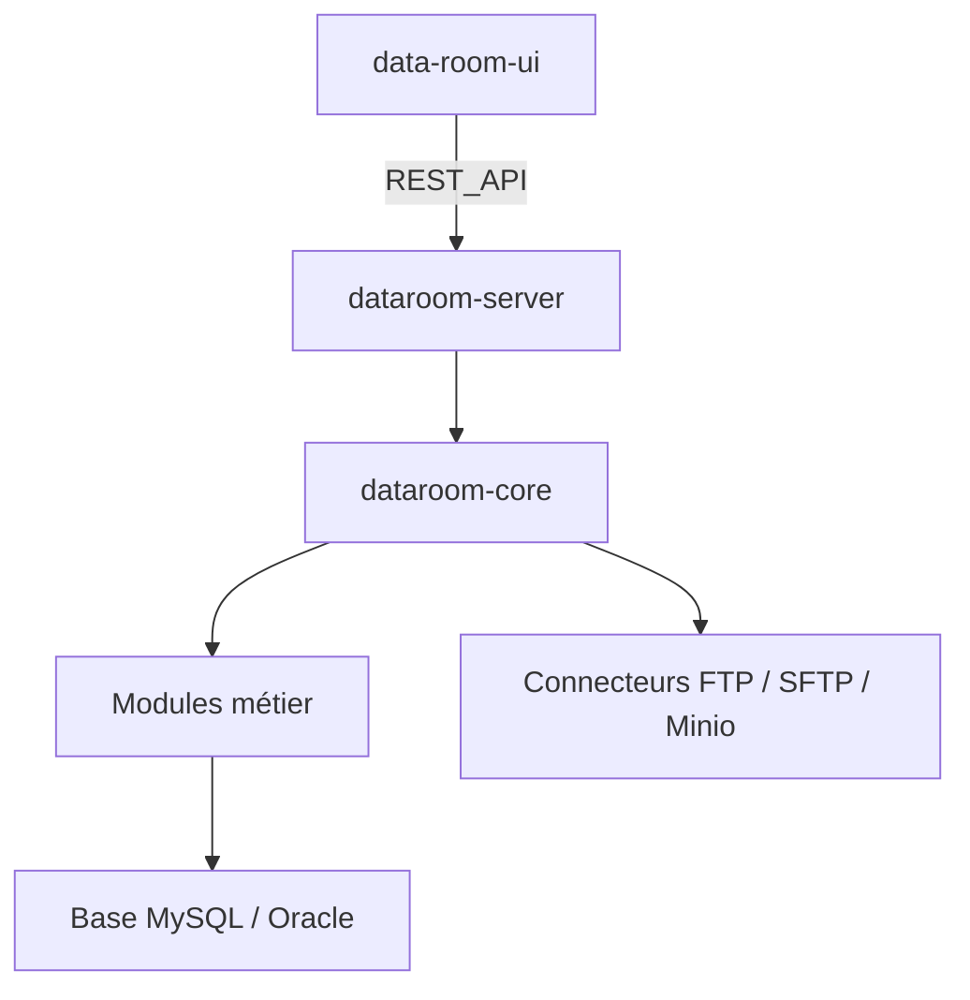

# gcpaas/DataRoom

> Open-source designer for control screens and dashboards, with AI agent generation (README in Chinese).

## The problem
Building data visualization screens requires connecting sources, cleaning, design and publishing.

## What it actually does
Offers two designers (grid page, free-positioning screen), more than 20 sources (MySQL, PostgreSQL, ClickHouse, Excel, MQTT, WebSocket...), JSON, SQL or HTTP datasets, user management and logs. An internal or external agent (MCP and skill) creates screens through conversation. Spring Boot 3, JDK 17 and Vue 3.

## How it is wired
Diagram based on the code's diagram.


## Trying it
```bash
docker run -d --name dataroom -p 8081:8081 gcpaas/dataroom:latest
```

## Cost and gotchas
Free code under Apache-2.0, but a commercial version exists. The Docker image only supports linux/arm64. Agent mode requires a key from a model provider (OpenAI or DashScope). The manual is password-protected via QQ.

## What it is not
Not a Western BI tool documented in English. No online demo.

## Alternatives
No alternative named in the README.

## For you
Worth watching: relevant for agent-driven dashboards via MCP, but the ecosystem and documentation are Chinese.
