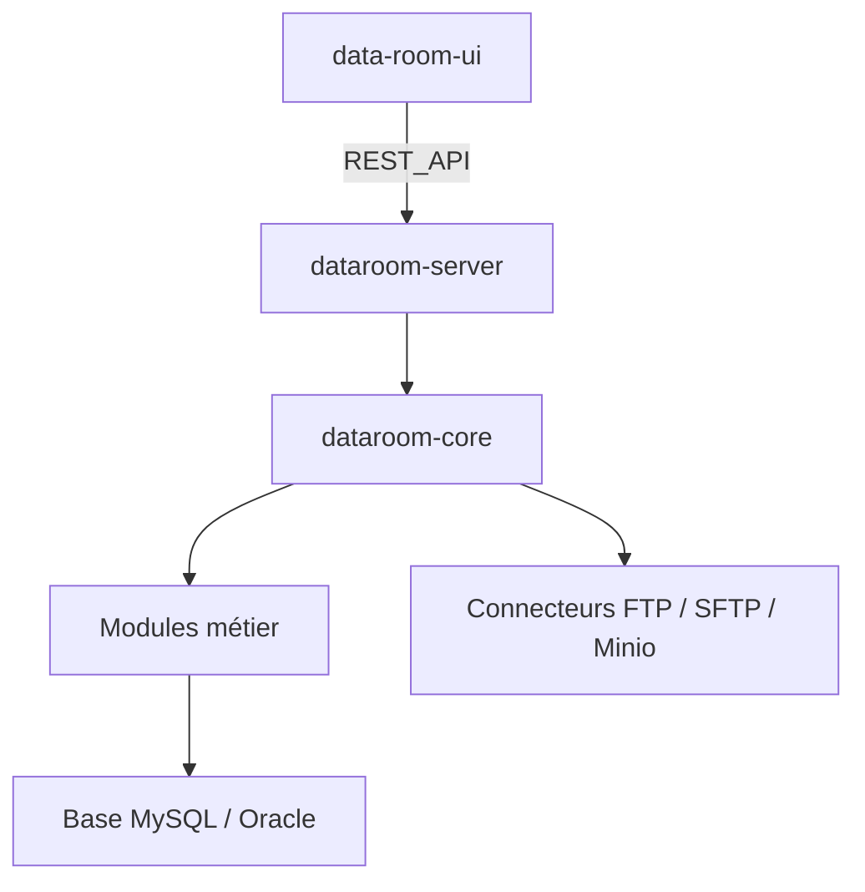

# gcpaas/DataRoom

> Concepteur open source d'écrans de pilotage et tableaux de bord, avec génération par agent IA (README en chinois).

## Le problème
Construire des écrans de visualisation de données demande de relier sources, nettoyage, conception et publication.

## Ce que ça fait vraiment
Offre deux concepteurs (page en grille, écran en positionnement libre), plus de 20 sources (MySQL, PostgreSQL, ClickHouse, Excel, MQTT, WebSocket…), des jeux de données JSON, SQL ou HTTP, la gestion d'utilisateurs et des journaux. Un agent interne ou externe (MCP et skill) crée des écrans en conversation. Spring Boot 3, JDK 17 et Vue 3.

## Comment c'est branché
Schéma d'après le diagramme du code.


## Essayer
```bash
docker run -d --name dataroom -p 8081:8081 gcpaas/dataroom:latest
```

## Coût et pièges
Code gratuit sous Apache-2.0, mais une version commerciale existe. L'image Docker ne gère que linux/arm64. Le mode agent exige une clé d'un fournisseur de modèle (OpenAI ou DashScope). Le manuel est protégé par un mot de passe via QQ.

## Ce que ce n'est pas
Pas un outil de BI occidental documenté en anglais. Pas de démo en ligne.

## Alternatives
Aucune alternative nommée dans le README.

## Pour toi
À surveiller : pertinent pour des tableaux de bord pilotés par agent via MCP, mais écosystème et documentation chinois.

