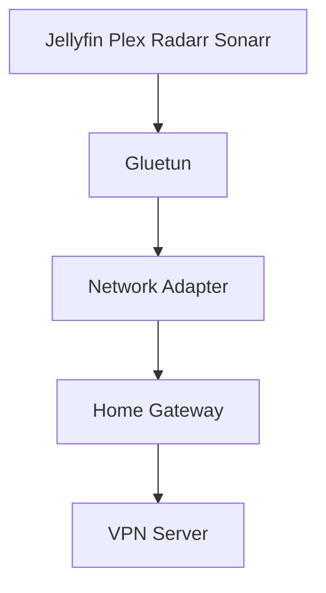

# geekau/mediastack

> A Docker Compose stack that installs Jellyfin or Plex with the *arr tools, a VPN and a reverse proxy.

## The problem
Setting up a media server by hand, with its automation tools, VPN, secure access and monitoring, is slow and fragile.

## What it actually does
A `docker-compose.yaml` configures more than thirty applications: Jellyfin, Plex, Radarr, Sonarr, Prowlarr, qBittorrent, SABnzbd, Traefik, Authentik, CrowdSec, Headscale, Grafana, Prometheus. Three network variants exist: all traffic through the Gluetun VPN, only downloads, or no VPN. The `restart.sh` script reads `.env` and manages the whole set.

## How it is wired
Diagram taken from the README.



## Trying it
```bash
sudo chmod 775 *sh
./restart.sh
./secure_authentik_database.sh
./create_guacamole_database.sh
```

## Cost and gotchas
The software is free, but you need Docker, a domain, forwarding of ports 80 and 443 for external access, and a VPN subscription for Gluetun. `restart.sh` purges non-persistent containers on every launch. The license is not declared.

## What it is not
Not a data stack: it is for managing and streaming a media library. In the full variant, a VPN drop stops the traffic of all containers.

## Alternatives
No alternative named in the README.

## For you
Ignore: it is a personal media server, outside your field, and the lack of a license forbids reusing the code.
