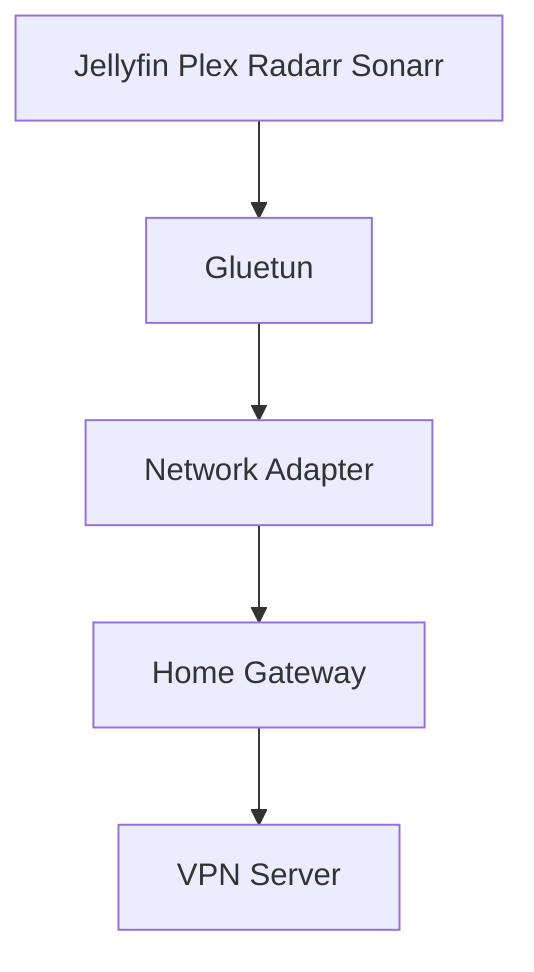

# geekau/mediastack

> Une pile Docker Compose qui installe Jellyfin ou Plex avec les outils *arr, un VPN et un proxy inverse.

## Le problème
Monter à la main un serveur multimédia avec ses outils d'automatisation, son VPN, son accès sécurisé et sa supervision est long et fragile.

## Ce que ça fait vraiment
Un `docker-compose.yaml` configure plus de trente applications : Jellyfin, Plex, Radarr, Sonarr, Prowlarr, qBittorrent, SABnzbd, Traefik, Authentik, CrowdSec, Headscale, Grafana, Prometheus. Trois variantes de réseau existent : tout le trafic via le VPN Gluetun, seulement les téléchargements, ou aucun VPN. Le script `restart.sh` lit `.env` et gère l'ensemble.

## Comment c'est branché
Diagramme tiré du README.



## Essayer
```bash
sudo chmod 775 *sh
./restart.sh
./secure_authentik_database.sh
./create_guacamole_database.sh
```

## Coût et pièges
Le logiciel est gratuit, mais il faut Docker, un domaine, la redirection des ports 80 et 443 pour l'accès externe, et un abonnement VPN pour Gluetun. `restart.sh` purge les conteneurs non persistants à chaque lancement. La licence n'est pas déclarée.

## Ce que ce n'est pas
Pas une pile de données : elle sert à gérer et diffuser une médiathèque. Dans la variante complète, une coupure du VPN arrête le trafic de tous les conteneurs.

## Alternatives
Aucune alternative nommée dans le README.

## Pour toi
À ignorer : c'est un serveur multimédia personnel, hors de ton métier, et l'absence de licence interdit de réutiliser le code.

