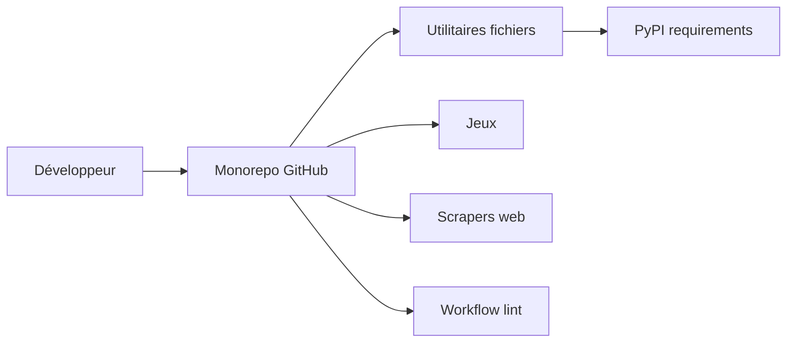

# geekcomputers/Python

> Collection of small Python automation and learning scripts, for beginners.

## The problem
A beginner looks for concrete examples of small programs (files, network, games) to read and modify.

## What it actually does
A monorepo of standalone scripts, with no shared service: file renaming, folder size, server ping, games (blackjack, space invader), downloads, scrapers (news, cricket), a WhatsApp chat analyzer, among others. Each folder sometimes has its own README and `requirements.txt`. Two CI workflows: lint and Datadog synthetic monitoring.

## How it is wired


## Trying it
```bash
# Aucune commande d'installation globale dans le README.
# Exemple cité pour un script :
# smart_file_organizer.py --path ... --interval ...
```

## Cost and gotchas
Free. Uneven quality: the author says he does not consider himself a programmer. Some scripts (WhatsApp, tweeter, YouTube) depend on third-party services that change. 504 open issues.

## What it is not
Not an installable library nor a coherent project: the scripts are independent, with no systematic tests.

## Alternatives
No alternative named in the README.

## For you
Ignore: too heterogeneous for a data/AI/MLOps profile; a targeted reference such as a Python cheat sheet is better.
