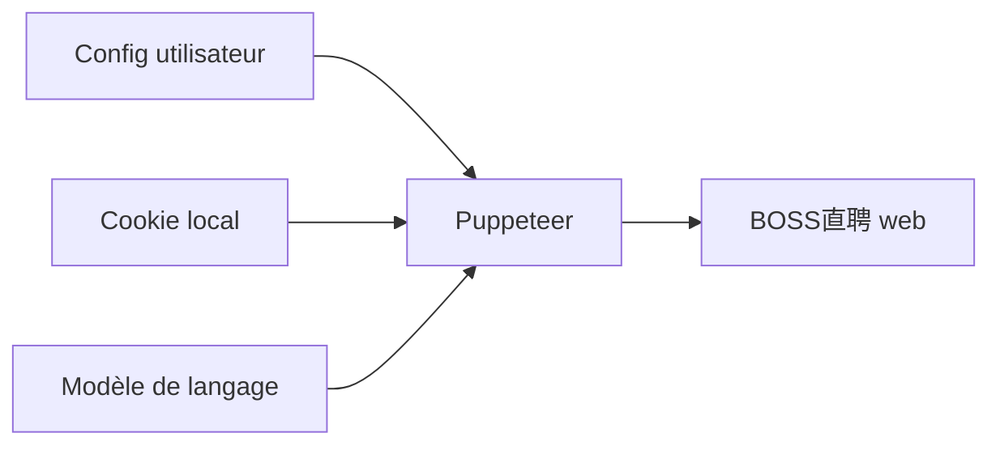

# geekgeekrun/geekgeekrun

> Desktop application that automatically starts conversations with recruiters on BOSS直聘, for job candidates.

## The problem
Applying en masse on a Chinese job platform requires repetitive clicks and manual sorting.

## What it actually does
- Automatically contacts recruiters according to preferences (location, salary, experience, position).
- Follows up with recruiters who read but did not reply, with a fixed message or one generated by a language model.
- Stores your login cookie locally; the bot simulates clicks via Puppeteer.
- Configuration interface, login wizard, model settings.

## How it is wired


## Trying it
```bash
sudo spctl --master-disable
xattr -cr /Applications/GeekGeekRun.app
```
These two commands (macOS) follow the installation from the Releases page (.exe, .deb or .dmg).

## Cost and gotchas
Free, but any language model is at your expense. Against the terms of BOSS直聘: risk of account blocking. Only one person tests it, on two machines. Disabling macOS protection is risky.

## What it is not
Not a general job search tool: a single platform. The site changes often and breaks the bot.

## Alternatives
No alternative named in the README.

## For you
Ignore: Chinese platform, ban risk, no license, single maintainer.
