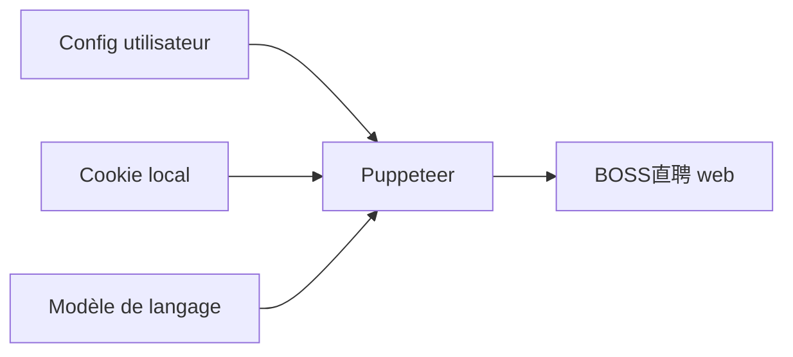

# geekgeekrun/geekgeekrun

> Application de bureau qui engage automatiquement la conversation avec des recruteurs sur BOSS直聘, pour candidats.

## Le problème
Postuler en masse sur une plateforme d'emploi chinoise demande des clics répétitifs et du tri manuel.

## Ce que ça fait vraiment
- Contacte automatiquement les recruteurs selon des préférences (lieu, salaire, expérience, poste).
- Relance les recruteurs qui ont lu sans répondre, avec un message fixe ou généré par un modèle de langage.
- Stocke ton cookie de connexion en local ; le robot simule les clics via Puppeteer.
- Interface de configuration, assistant de connexion, réglages de modèles.

## Comment c'est branché


## Essayer
```bash
sudo spctl --master-disable
xattr -cr /Applications/GeekGeekRun.app
```
Ces deux commandes (macOS) suivent l'installation depuis la page Releases (.exe, .deb ou .dmg).

## Coût et pièges
Gratuit, mais le modèle de langage éventuel est à ta charge. Contraire aux conditions de BOSS直聘 : risque de blocage du compte. Une seule personne teste, sur deux machines. Désactiver la protection macOS est risqué.

## Ce que ce n'est pas
Pas un outil de recherche d'emploi général : une seule plateforme. Le site change souvent et casse le robot.

## Alternatives
Aucune alternative nommée dans le README.

## Pour toi
À ignorer : plateforme chinoise, risque de bannissement, pas de licence, mainteneur unique.

