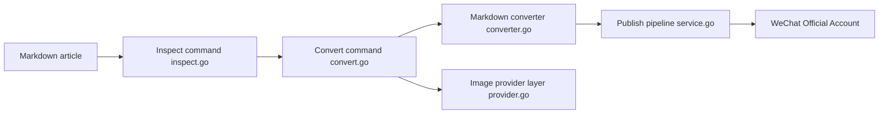

# geekjourneyx/md2wechat-skill

> CLI for agents that converts Markdown into WeChat Official Account articles and sends them as drafts.

## The problem
Formatting and publishing an article on a WeChat account (specific HTML, images, cover, draft) is manual.

## What it actually does
Commands `inspect`, `preview`, `convert` (with image upload and draft creation on demand), `write`, `humanize`, `title suggest`, cover and infographic generation, plus JSON discovery commands for Claude Code, Codex and others. v3.6.0 prepares Zhihu, CSDN and Toutiao drafts via an already logged-in browser. The full final rendering requires a paid API mode.

## How it is wired


## Trying it
```bash
npm install -g @geekjourneyx/md2wechat
md2wechat version --json
md2wechat config init --json
md2wechat inspect article.md --json
md2wechat convert article.md --output article.html
```

## Cost and gotchas
API mode (48 themes, `:::` modules) costs 199 ¥ for life; the free mode produces a prompt that an external LLM has to finish. Image providers need your own key. WeChat account and IP allowlist required.

## What it is not
Not open source in the usual sense: "Source Available", with commercial use, SaaS, redistribution and training data subject to a commercial licence. README in Chinese.

## Alternatives
No alternative named in the README.

## For you
Ignore: very specific to WeChat, paid full mode and restrictive licence, unrelated to a data/AI profile.
