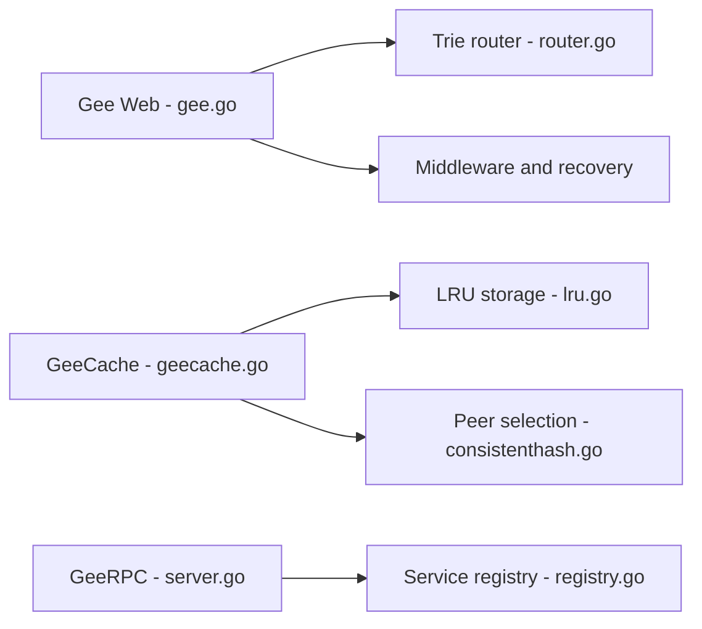

# geektutu/7days-golang

> Series of Go tutorials that reimplements a web framework, a cache, an ORM and an RPC in seven days.

## The problem
Understanding how a web framework, a distributed cache, an ORM or an RPC works by building them yourself.

## What it actually does
Four step-by-step mini-projects: Gee (gin-like: trie router, context, groups, middlewares, panic recovery), GeeCache (groupcache-like: LRU, consistent hashing, singleflight, Protobuf), GeeORM (xorm-like: mapping, hooks, transactions, migrations), GeeRPC (on top of `net/rpc`: codec, timeout, load balancing, registry). WebAssembly demos. Main text in Chinese and English.

## How it is wired

## Trying it
No command documented in the README; each day links to its code.

## Cost and gotchas
Free. Educational content, not intended for production.

## What it is not
Not a reusable library: these are didactic, heavily reduced implementations.

## Alternatives
No alternative is named in the README (gin, groupcache, gorm and xorm are the models imitated).

## For you
Ignore: excellent for learning systems Go, but outside the needs of a data/AI/MLOps profile.
