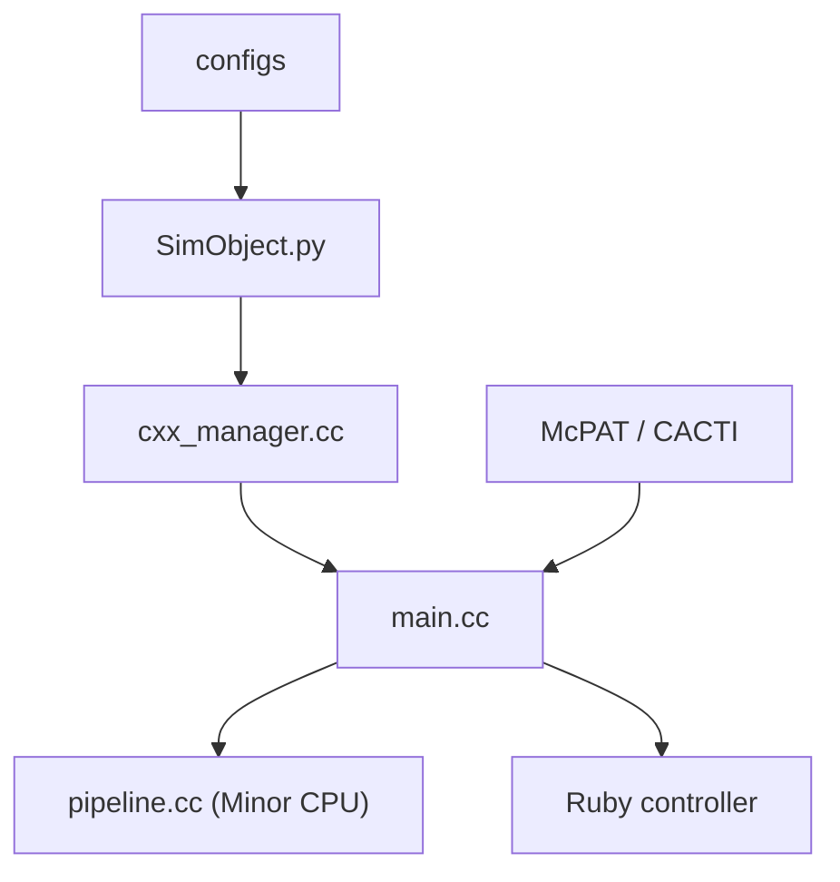

# gem5/gem5

> Modular simulator for computer architecture research: processors, memory, systems.

## The problem
Evaluating a new processor or memory hierarchy before committing it to silicon requires an executable model.

## What it actually does
Instantiates "SimObjects" configured in Python, simulates CPUs (e.g. the Minor pipeline), GPUs, Ruby memory coherence, with McPAT/CACTI power models and optional SystemC integration. Supports ARM, RISC-V, X86, MIPS, POWER, SPARC. The execution entry point is not confirmed by the diagram.

## How it is wired
Diagram based on the code diagram.



## Trying it
```bash
scons build/ALL/gem5.opt
# ISA unique possible : remplacer ALL par ARM, NULL, MIPS, POWER, RISCV, SPARC ou X86
```

## Cost and gotchas
Free. Long build: g++ or clang, Python, SCons, zlib, m4 and optional protobuf. Full-system simulations require kernels and disk images separately (gem5 Resources).

## What it is not
Not a fast emulator for running programs: it is a micro-architecture simulator, slow by design.

## Alternatives
No alternative named in the README.

## For you
Worth watching if you work on AI accelerators or GPU modeling; otherwise of no direct interest.
