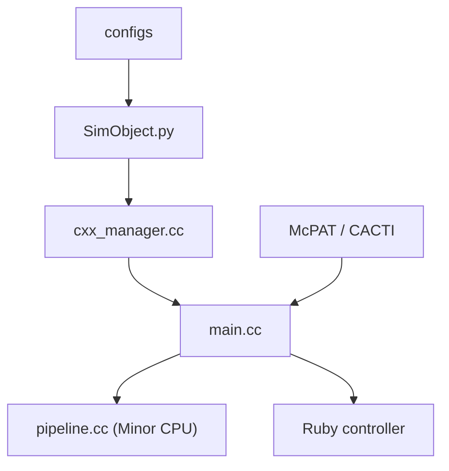

# gem5/gem5

> Simulateur modulaire pour la recherche en architecture des ordinateurs : processeurs, mémoire, systèmes.

## Le problème
Évaluer un nouveau processeur ou une hiérarchie mémoire avant de le fondre en silicium exige un modèle exécutable.

## Ce que ça fait vraiment
Instancie des « SimObjects » configurés en Python, simule CPU (ex. pipeline Minor), GPU, cohérence mémoire Ruby, avec modèles de puissance McPAT/CACTI et intégration SystemC optionnelle. Supporte ARM, RISC-V, X86, MIPS, POWER, SPARC. Le point d'entrée d'exécution n'est pas confirmé par le diagramme.

## Comment c'est branché
Schéma d'après le diagramme du code.



## Essayer
```bash
scons build/ALL/gem5.opt
# ISA unique possible : remplacer ALL par ARM, NULL, MIPS, POWER, RISCV, SPARC ou X86
```

## Coût et pièges
Gratuit. Compilation longue : g++ ou clang, Python, SCons, zlib, m4 et protobuf optionnel. Les simulations plein système demandent noyaux et images disque à part (gem5 Resources).

## Ce que ce n'est pas
Pas un émulateur rapide pour exécuter des programmes : c'est un simulateur de micro-architecture, lent par construction.

## Alternatives
Aucune alternative nommée dans le README.

## Pour toi
À surveiller si tu travailles sur des accélérateurs IA ou la modélisation de GPU ; sinon sans intérêt direct.

