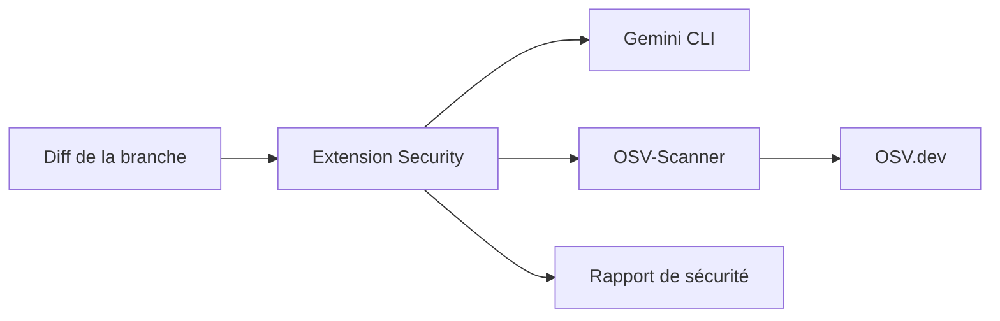

# gemini-cli-extensions/security

> Gemini CLI extension that analyzes code changes and dependencies to spot vulnerabilities.

## The problem
Vulnerabilities slip into pull requests before any security review.

## What it actually does
Adds `/security:analyze`, which examines the branch diff against `origin/HEAD` with Gemini (secrets, injections, authentication, LLM security), and `/security:scan-deps`, which queries OSV.dev through OSV-Scanner. A GitHub workflow lets you plug it into PR reviews. The authors claim 90% precision and 93% recall on a small OpenSSF dataset.

## How it is wired
Simplified diagram based on the sheet, no diagram provided.


## Trying it
```bash
gemini extensions install https://github.com/gemini-cli-extensions/security
/security:analyze
/security:analyze --json
/security:scan-deps
```

## Cost and gotchas
Requires Gemini CLI 0.4.0 or later and access to Gemini, whose quotas and billing are not detailed. The analyzed code is sent to the model. Non-interactive mode is planned but not shipped. Last push in July 2026: to check against the one-year threshold, not exceeded here.

## What it is not
Not a full audit: the README speaks of a first-level analysis. It replaces neither manual review nor other tools.

## Alternatives
Not documented in the README.

## For you
Worth watching: useful as a first pass on AI or pipeline code if you already use Gemini CLI, but the precision figures were measured by the authors on a small dataset.
