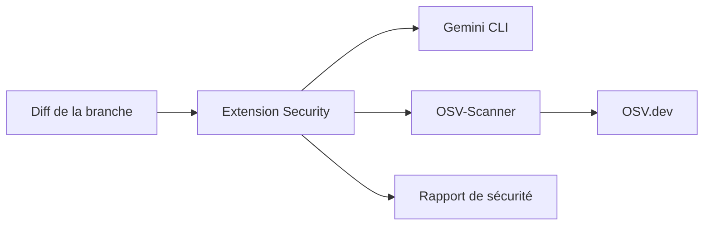

# gemini-cli-extensions/security

> Extension de Gemini CLI qui analyse les changements de code et les dépendances pour repérer des failles.

## Le problème
Les failles s'introduisent dans les pull requests avant toute revue de sécurité.

## Ce que ça fait vraiment
Ajoute `/security:analyze`, qui examine le diff de la branche contre `origin/HEAD` avec Gemini (secrets, injections, authentification, sécurité des LLM), et `/security:scan-deps`, qui interroge OSV.dev via OSV-Scanner. Un workflow GitHub permet de l'intégrer aux revues de PR. Les auteurs annoncent 90 % de précision et 93 % de rappel sur un jeu OpenSSF à petit effectif.

## Comment c'est branché
Schéma simplifié d'après la fiche, sans diagramme fourni.


## Essayer
```bash
gemini extensions install https://github.com/gemini-cli-extensions/security
/security:analyze
/security:analyze --json
/security:scan-deps
```

## Coût et pièges
Demande Gemini CLI 0.4.0 ou plus et un accès à Gemini, dont les quotas ou la facturation ne sont pas détaillés. Le code analysé part vers le modèle. Le mode non interactif est prévu mais pas livré. Dernier push en juillet 2026 : à vérifier selon le seuil d'un an, non dépassé ici.

## Ce que ce n'est pas
Ce n'est pas un audit complet : le README parle d'analyse de premier niveau. Il ne remplace ni revue manuelle ni autres outils.

## Alternatives
Non documenté dans le README.

## Pour toi
À surveiller : utile en première passe sur du code d'IA ou de pipelines si tu utilises déjà Gemini CLI, mais les chiffres de précision sont mesurés par les auteurs sur un petit jeu.

