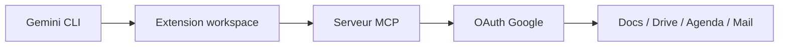

# gemini-cli-extensions/workspace

> Gemini CLI extension that drives Docs, Drive, Gmail, Calendar and Chat from the terminal.

## The problem
Going back and forth between the terminal and Google Workspace applications to read, write or search.

## What it actually does
Exposes Docs, Sheets, Slides, mail, chat and calendar to Gemini CLI via an MCP server. Commands such as `/calendar:get-schedule` and `/drive:search`. A browserless login tool is provided for SSH or WSL. The server can read, modify and delete the Google account's data.

## How it is wired
Simplified diagram based on the sheet, no diagram provided.


## Trying it
```bash
gemini extensions install https://github.com/gemini-cli-extensions/workspace
npm run auth-utils -- login
```

## Cost and gotchas
A Google account and Gemini CLI are required. Risk of indirect prompt injection: a booby-trapped email or document can hijack the session and act on your data.

## What it is not
It is not a read-only tool: it can delete. It is not suited to untrusted content.

## Alternatives
No alternative named in the README.

## For you
Worth watching: handy if you live in Gemini CLI and Google Workspace, but the write permissions require reviewing every action.
