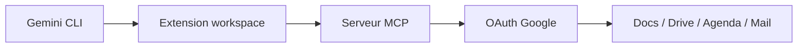

# gemini-cli-extensions/workspace

> Extension de Gemini CLI qui pilote Docs, Drive, Gmail, Agenda et Chat depuis le terminal.

## Le problème
Aller et venir entre le terminal et les applications Google Workspace pour lire, écrire ou chercher.

## Ce que ça fait vraiment
Expose Docs, Sheets, Slides, mail, chat et agenda à Gemini CLI via un serveur MCP. Commandes comme `/calendar:get-schedule` et `/drive:search`. Un outil de connexion sans navigateur sert pour SSH ou WSL. Le serveur peut lire, modifier et supprimer les données du compte Google.

## Comment c'est branché
Schéma simplifié d'après la fiche, sans diagramme fourni.


## Essayer
```bash
gemini extensions install https://github.com/gemini-cli-extensions/workspace
npm run auth-utils -- login
```

## Coût et pièges
Il faut un compte Google et Gemini CLI. Risque d'injection de prompt indirecte : un mail ou un document piégé peut détourner la session et agir sur tes données.

## Ce que ce n'est pas
Ce n'est pas un outil en lecture seule : il peut supprimer. Ce n'est pas adapté à du contenu non fiable.

## Alternatives
Aucune alternative nommée dans le README.

## Pour toi
À surveiller : pratique si tu vis dans Gemini CLI et Google Workspace, mais les droits d'écriture exigent de relire chaque action.

