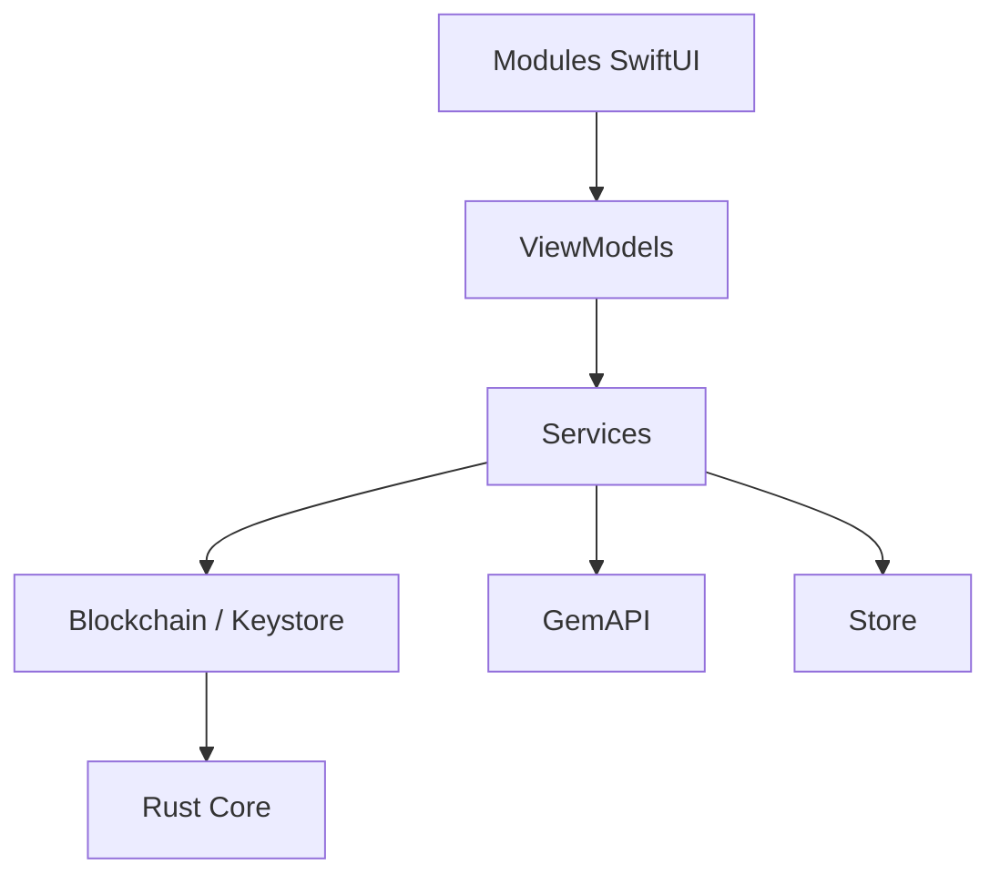

# gemwalletcom/gem-ios

> iOS crypto wallet app in SwiftUI, with a Rust core, for self-custody of your own funds.

## The problem
Holding and swapping cryptocurrencies across several chains without handing your keys to a third party.

## What it actually does
Modular SwiftUI app (Onboarding, WalletTab, Swap, Staking, PriceAlerts, NFT, QRScanner), MVVM, services (assets, balances, prices, chains), Blockchain, Keystore, Primitives and Store packages. The cryptographic core is the Rust library `core` (Gemstone), as a submodule. Talks to `GemAPI` and WalletConnect.

## How it is wired


## Trying it
```bash
git clone https://github.com/gemwalletcom/gem-ios.git --recursive
brew install just
just bootstrap
```

## Cost and gotchas
Free; you need Xcode and, by default, an Apple silicon Mac. Archived repository: development probably continued elsewhere, not stated.

## What it is not
Not a reusable library. GPL-3.0 license: any derivative must stay open. No security audit is cited in the README.

## Alternatives
None named in the README.

## For you
Ignore: archived mobile crypto wallet, no use in data, AI or MLOps work.
