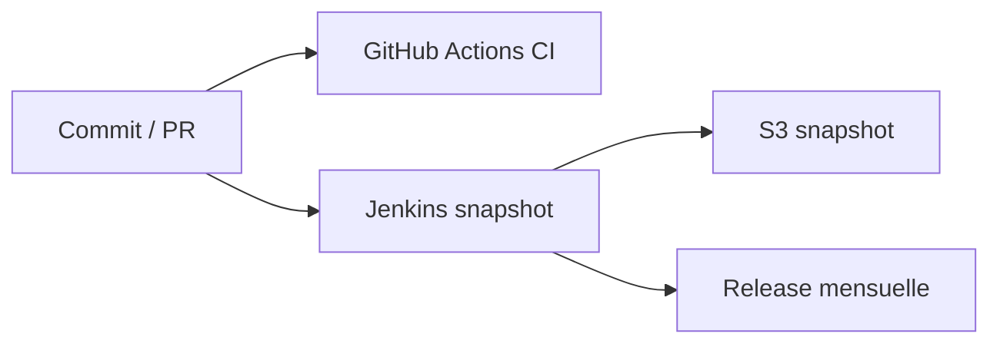

# geneontology/go-ontology

> Source code of the Gene Ontology, intended for its developers and editors.

## The problem
Maintaining a shared biological ontology requires a versioned repo and a publishing pipeline.

## What it actually does
Contains the sources of the GO ontology. GitHub Actions tests every commit, Jenkins produces SNAPSHOTs every two days and monthly releases. Production versions are downloaded from the GO website, not from here.

## How it is wired

## Trying it
No command documented; download from the GO website, not from this repo.

## Cost and gotchas
Free, CC-BY-4.0. 735 open issues. Do not use this repo for production.

## What it is not
It is not the download source for stable releases.

## Alternatives
No alternative named in the README.

## For you
Worth watching: a reference if you annotate genes for bio models, but take the releases from the website.
