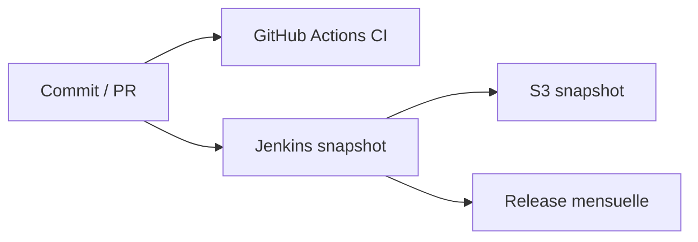

# geneontology/go-ontology

> Code source de l'ontologie Gene Ontology, destiné à ses développeurs et éditeurs.

## Le problème
Maintenir une ontologie biologique partagée exige un dépôt versionné et un pipeline de publication.

## Ce que ça fait vraiment
Contient les sources de l'ontologie GO. GitHub Actions teste chaque commit, Jenkins produit des SNAPSHOT tous les deux jours et des releases mensuelles. Les versions de production se téléchargent sur le site GO, pas ici.

## Comment c'est branché

## Essayer
Aucune commande documentée ; télécharger depuis le site GO, pas depuis ce dépôt.

## Coût et pièges
Gratuit, CC-BY-4.0. 735 issues ouvertes. Ne pas utiliser ce dépôt pour la production.

## Ce que ce n'est pas
Ce n'est pas la source de téléchargement des versions stables.

## Alternatives
Aucune alternative nommée dans le README.

## Pour toi
À surveiller : référence si tu annotes des gènes pour des modèles bio, mais prends les releases du site.

