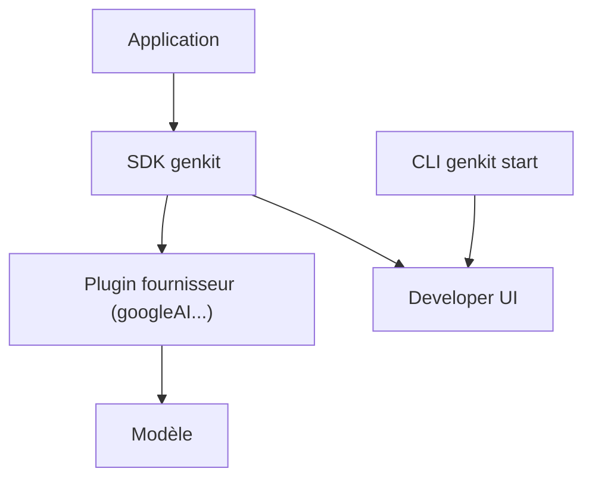

# genkit-ai/genkit

> Google framework for building AI applications: generation, tools, flows and RAG, in several languages.

## The problem
Wiring several model providers, structuring outputs and debugging AI flows requires a lot of repetitive code.

## What it actually does
Unified SDK (JavaScript/TypeScript, Go, Python in beta, Dart in preview) to call models from Google, OpenAI, Anthropic, Ollama. Provides structured output, tool calling, prompt templates, persistent chat, workflows and RAG. A CLI and a local interface let you run, trace and evaluate flows. Production monitoring in the Firebase console.

## How it is wired
Simplified diagram based on the sheet, no diagram provided.



## Trying it
```bash
npm install -g genkit-cli
genkit start --
npx skills add genkit-ai/skills --skill developing-genkit-js
```

## Cost and gotchas
The model provider's API key is at your expense; Vertex AI uses a different authentication. Python in beta, Dart in preview. Production monitoring goes through Firebase.

## What it is not
Not a model or a host: it orchestrates third-party models. The "production-ready" label comes from the README, not from a verification.

## Alternatives
No alternative named in the README.

## For you
Watch: handy for prototyping multi-provider AI flows, but the monitoring ecosystem leans toward Firebase.
