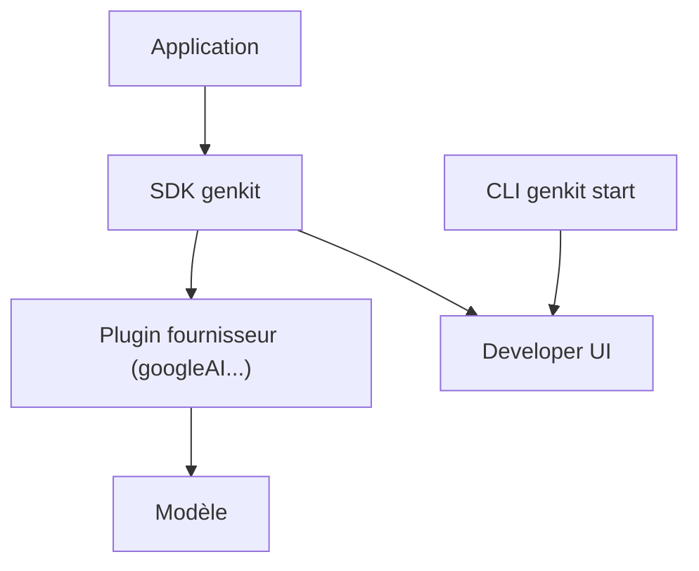

# genkit-ai/genkit

> Framework Google pour construire des applications IA : génération, outils, flux et RAG, en plusieurs langages.

## Le problème
Brancher plusieurs fournisseurs de modèles, structurer les sorties et déboguer des flux d'IA demande beaucoup de code répétitif.

## Ce que ça fait vraiment
SDK unifié (JavaScript/TypeScript, Go, Python en bêta, Dart en préversion) pour appeler des modèles de Google, OpenAI, Anthropic, Ollama. Fournit sortie structurée, appel d'outils, modèles de prompts, chat persistant, workflows et RAG. Une CLI et une interface locale permettent de lancer, tracer et évaluer les flux. Surveillance de production dans la console Firebase.

## Comment c'est branché
Schéma simplifié d'après la fiche, sans diagramme fourni.



## Essayer
```bash
npm install -g genkit-cli
genkit start --
npx skills add genkit-ai/skills --skill developing-genkit-js
```

## Coût et pièges
Clé d'API du fournisseur de modèle à ta charge ; Vertex AI utilise une autre authentification. Python en bêta, Dart en préversion. Le suivi en production passe par Firebase.

## Ce que ce n'est pas
Pas un modèle ni un hébergeur : il orchestre des modèles tiers. Le qualificatif « prêt pour la production » vient du README, pas d'une vérification.

## Alternatives
Aucune alternative nommée dans le README.

## Pour toi
À surveiller : pratique pour prototyper des flux d'IA multi-fournisseurs, mais l'écosystème de suivi penche vers Firebase.

