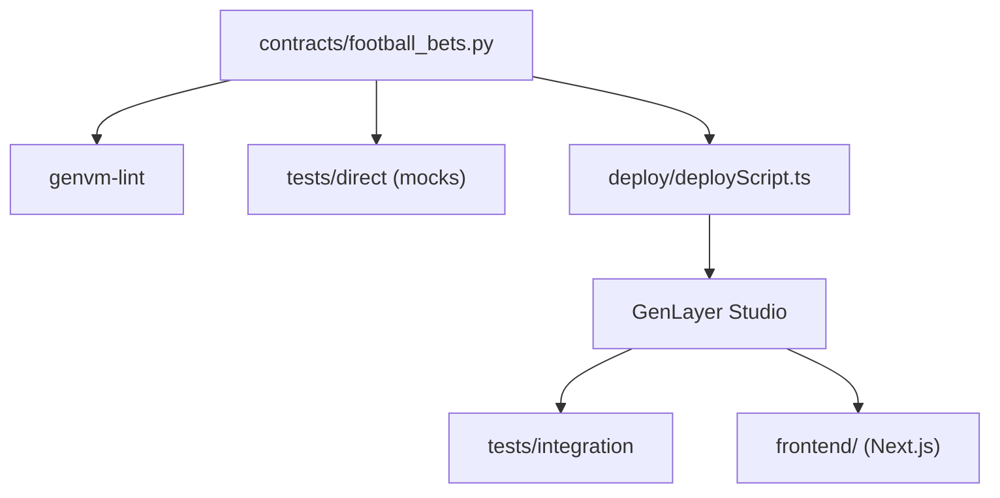

# genlayerlabs/genlayer-project-boilerplate

> GenLayer project template with a betting smart contract, tests, a linter and a frontend.

## The problem
Writing a first GenLayer contract requires knowing its determinism rules, its testing tools and deployment.

## What it actually does
Provides a Python "Football Bets" contract that reads a result on BBC Sport and has an LLM extract it, validated by the equivalence principle. The repo includes a linter (`genvm-lint`), direct in-memory tests with mocks, integration tests against GenLayer Studio, CI and a Next.js 15 frontend.

## How it is wired

Diagram drawn from the README structure.

## Trying it
```bash
python3 -m venv .venv
source .venv/bin/activate
pip install -r requirements.txt
genvm-lint check contracts/football_bets.py
pytest tests/direct/ -v
gltest tests/integration/ -v -s
```

## Cost and gotchas
Python 3.12 minimum, the `genlayer` CLI installed globally (npm) and a local or hosted GenLayer Studio for integration and deployment.

## What it is not
Not a reusable library: it is an example to copy. The README says "production-ready" for the frontend, which nothing here proves.

## Alternatives
No alternative named in the README.

## For you
Worth watching only if you are exploring contracts that call LLMs on the GenLayer blockchain: otherwise outside your data and MLOps scope.
