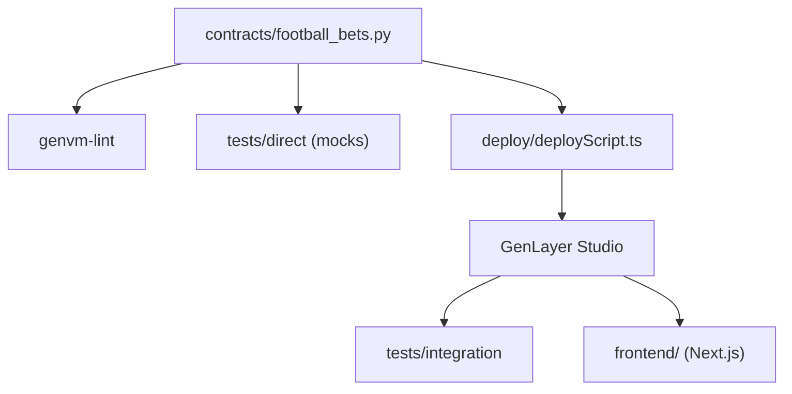

# genlayerlabs/genlayer-project-boilerplate

> Modèle de projet GenLayer avec un contrat intelligent de paris, des tests, un linter et un frontend.

## Le problème
Écrire un premier contrat GenLayer exige de connaître ses règles de déterminisme, ses outils de test et le déploiement.

## Ce que ça fait vraiment
Fournit un contrat Python « Football Bets » qui lit un résultat sur BBC Sport et le fait extraire par un LLM, validé par le principe d'équivalence. Le dépôt inclut un linter (`genvm-lint`), des tests directs en mémoire avec mocks, des tests d'intégration contre GenLayer Studio, une CI et un frontend Next.js 15.

## Comment c'est branché

Schéma tiré de la structure du README.

## Essayer
```bash
python3 -m venv .venv
source .venv/bin/activate
pip install -r requirements.txt
genvm-lint check contracts/football_bets.py
pytest tests/direct/ -v
gltest tests/integration/ -v -s
```

## Coût et pièges
Python 3.12 minimum, CLI `genlayer` en global (npm) et un GenLayer Studio local ou hébergé pour l'intégration et le déploiement.

## Ce que ce n'est pas
Pas une bibliothèque réutilisable : c'est un exemple à copier. Le README parle de « production-ready » pour le frontend, ce que rien ne prouve ici.

## Alternatives
Aucune alternative nommée dans le README.

## Pour toi
À surveiller seulement si tu explores les contrats appelant des LLM sur la blockchain GenLayer : sinon hors périmètre data et MLOps.

