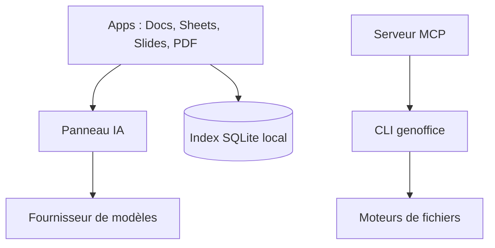

# genspark-ai/genoffice

> Free office suite that edits real .docx, .xlsx, .pptx and PDF files with a built-in AI agent.

## The problem
Office documents have to be edited by hand, or converted into Markdown approximations by agents.

## What it actually does
Desktop application (macOS, Windows, Linux) that opens and rewrites only what is modified in Office files. The AI applies changes as tracked revisions or undoable diffs. Added to this are PDF editing, Markdown, HTML, local full-text search, local conversions, and a `genoffice` CLI with a skill and an MCP server. No architecture diagram is provided.

## How it is wired


## Trying it
```bash
genoffice --version
genoffice info report.docx --json
genoffice convert report.md --to pdf
genoffice create --type docx --from notes.md --out notes.docx
genoffice render report.docx --out shots/
```

## Cost and gotchas
Free; the AI requires a Genspark login or a provider key at your expense. Only AI calls leave the machine; selection masking does not apply to the CLI or MCP. The README provided is truncated.

## What it is not
Not a faithful clone of Microsoft Office: ODF, `.doc` and Hancom formats open read-only and are re-saved as OOXML.

## Alternatives
Microsoft Office: cited as the reference the software aims to replace.

## For you
Worth watching: the CLI and MCP give your agents real Office files, but the project is very recent.
