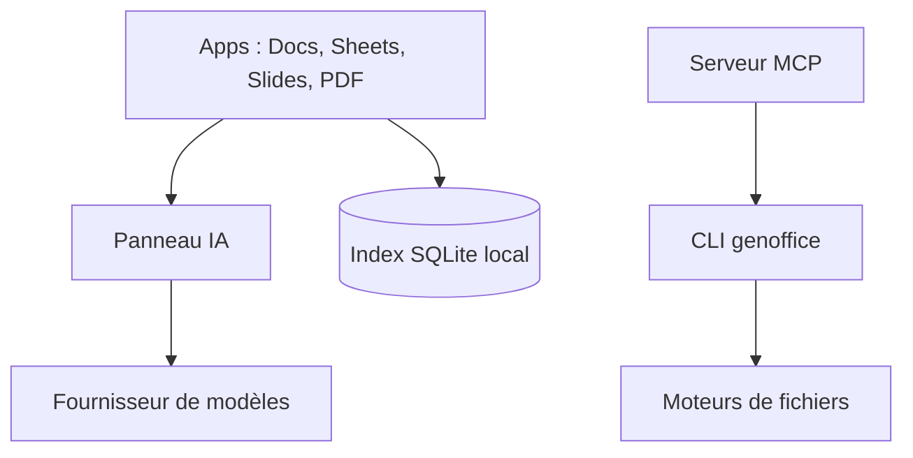

# genspark-ai/genoffice

> Suite bureautique libre qui édite les vrais .docx, .xlsx, .pptx et PDF avec un agent IA intégré.

## Le problème
Les documents Office doivent être édités à la main, ou convertis en approximations Markdown par les agents.

## Ce que ça fait vraiment
Application de bureau (macOS, Windows, Linux) qui ouvre et réécrit uniquement ce qui est modifié dans les fichiers Office. L'IA applique des modifications en révisions suivies ou en diffs annulables. S'y ajoutent édition de PDF, Markdown, HTML, recherche locale en texte intégral, conversions locales, et un CLI `genoffice` avec skill et serveur MCP. Aucun schéma d'architecture n'est fourni.

## Comment c'est branché


## Essayer
```bash
genoffice --version
genoffice info report.docx --json
genoffice convert report.md --to pdf
genoffice create --type docx --from notes.md --out notes.docx
genoffice render report.docx --out shots/
```

## Coût et pièges
Gratuit ; l'IA demande une connexion Genspark ou une clé fournisseur à ta charge. Seuls les appels IA quittent la machine ; le masquage de sélections ne concerne pas le CLI ni MCP. Le README fourni est tronqué.

## Ce que ce n'est pas
Pas un clone fidèle de Microsoft Office : les formats ODF, `.doc` et Hancom s'ouvrent en lecture seule et se réenregistrent en OOXML.

## Alternatives
Microsoft Office : cité comme référence que le logiciel veut remplacer.

## Pour toi
À surveiller : le CLI et le MCP donnent à tes agents de vrais fichiers Office, mais le projet est très récent.

