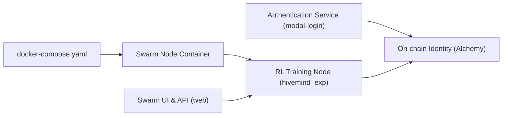

# gensyn-ai/rl-swarm

> Peer-to-peer collaborative reinforcement learning system, connected to the Gensyn testnet.

## The problem
Training models by RL collectively, without a central server, with a verifiable participant identity.

## What it actually does
Each node trains a small model locally (Solver role on code tasks with Qwen2.5-Coder-0.5B, via GRPO) and shares its rollouts with peers over a DHT/gossip network (Hivemind, GenRL). Login via Alchemy, on-chain identity tied to `swarm.pem`, testnet dashboard. The README says no official swarm is active for now.

## How it is wired


## Trying it
```bash
git clone https://github.com/gensyn-ai/rl-swarm
docker compose run --rm --build -Pit swarm-gpu
python3 -m venv .venv
source .venv/bin/activate
./run_rl_swarm.sh
```

## Cost and gotchas
32 GB of RAM minimum on CPU, or a CUDA GPU (3090 to H100). Email account and HuggingFace token optional. Losing `swarm.pem` breaks the link to your identity. Last push in January 2026.

## What it is not
Not a general training tool: it serves an experimental network with participation points, with no official swarm currently active.

## Alternatives
No alternative named in the README.

## For you
Ignore: experimental software tied to an inactive testnet, with on-chain identity, of no useful purpose for an MLOps pipeline.
