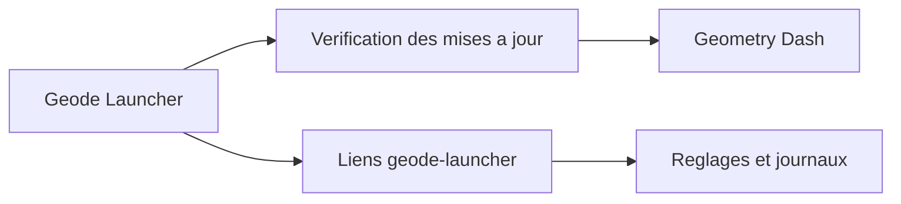

# geode-sdk/android-launcher

> Android launcher that starts a standard copy of Geometry Dash with the Geode mod loader.

## The problem
Geode, the Geometry Dash mod loader, cannot be installed simply on Android.

## What it actually does
Launches Geometry Dash with Geode added. It exposes `geode-launcher://` links to recover from a failure: force the launch confirmation, launch in safe mode, open settings, logs and crash dumps. Nothing else is described.

## How it is wired
Simplified diagram based on the sheet, no diagram provided.



## Trying it
The links can be pasted into a browser or sent through ADB:

```bash
geode-launcher://main/launch?safe-mode=true
```

## Cost and gotchas
Free, but you must own Geometry Dash. Installing the launcher is not described in the README.

## What it is not
Not a game: it does not contain Geometry Dash. Not a mod SDK either, it is only the Android launcher.

## Alternatives
No alternative named in the README.

## For you
Ignore: game modding tool, unrelated to data, AI or MLOps.
