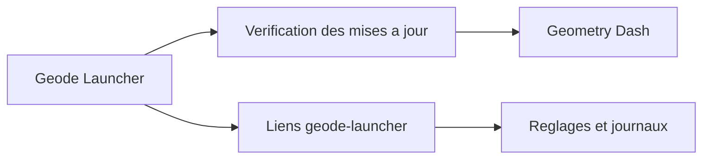

# geode-sdk/android-launcher

> Lanceur Android qui démarre une copie standard de Geometry Dash avec le chargeur de mods Geode.

## Le problème
Geode, le chargeur de mods de Geometry Dash, ne s'installe pas simplement sur Android.

## Ce que ça fait vraiment
Lance Geometry Dash avec Geode ajouté. Il expose des liens `geode-launcher://` pour sortir d'une panne : forcer la confirmation du lancement, lancer en mode sans échec, ouvrir réglages, journaux et vidage de plantages. Rien d'autre n'est décrit.

## Comment c'est branché
Schéma simplifié d'après la fiche, sans diagramme fourni.



## Essayer
Les liens se collent dans un navigateur ou passent par ADB :

```bash
geode-launcher://main/launch?safe-mode=true
```

## Coût et pièges
Gratuit, mais il faut posséder Geometry Dash. L'installation du lanceur n'est pas décrite dans le README.

## Ce que ce n'est pas
Pas un jeu : il ne contient pas Geometry Dash. Pas un SDK de mods non plus, c'est seulement le lanceur Android.

## Alternatives
Aucune alternative nommée dans le README.

## Pour toi
Ignorer : outil de modding de jeu, sans rapport avec la data, l'IA ou le MLOps.

