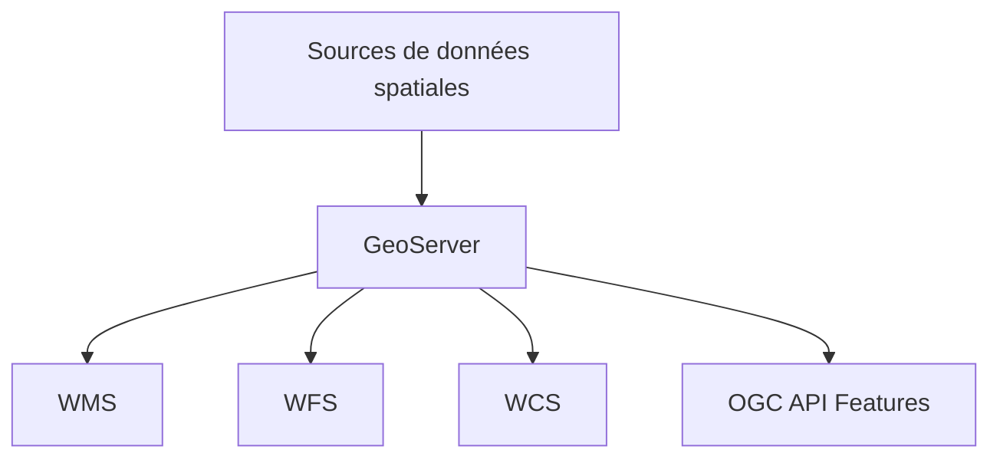

# geoserver/geoserver

> Open-source Java server that publishes and edits geospatial data through OGC standards.

## The problem
Sharing map data between systems requires standardized services, not proprietary formats.

## What it actually does
It publishes data from a variety of spatial sources through WFS, WCS and WMS, plus OGC API - Features, CSW and WPS. It is cited as a reference implementation of WFS, WCS, GeoPackage and GeoTIFF, and handles GML and Shapefile. The project is community-run.

## How it is wired
Simplified diagram based on the sheet, no diagram provided.



## Trying it
```bash
mvn clean install
python3 -m venv venv
source venv/bin/activate
pip install -r requirements.txt
mkdocs serve --livereload --no-directory-urls -o
```
The first two lines are run from the `src` folder.

## Cost and gotchas
Free. It needs Java and Maven (not listed among the possible prerequisites). License to be verified. Bug tracking goes through JIRA, not GitHub.

## What it is not
Not a desktop GIS tool or an analysis engine: it is a publishing server. The README describes neither installation nor configuration; it points to the user guide.

## Alternatives
No alternative named in the README.

## For you
Worth watching: useful if you need to serve geographic data to applications, otherwise off-topic for your models.
