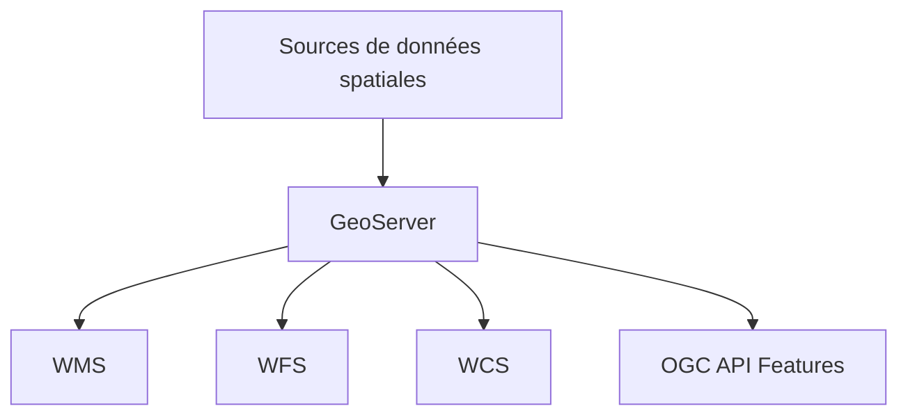

# geoserver/geoserver

> Serveur Java open source qui publie et édite des données géospatiales via les standards OGC.

## Le problème
Partager des données cartographiques entre systèmes exige des services standardisés, pas des formats propriétaires.

## Ce que ça fait vraiment
Il publie des données issues de sources spatiales variées via WFS, WCS et WMS, plus OGC API - Features, CSW et WPS. Il est cité comme implémentation de référence de WFS, WCS, GeoPackage et GeoTIFF, et gère GML et Shapefile. Le projet est porté par une communauté.

## Comment c'est branché
Schéma simplifié d'après la fiche, sans diagramme fourni.



## Essayer
```bash
mvn clean install
python3 -m venv venv
source venv/bin/activate
pip install -r requirements.txt
mkdocs serve --livereload --no-directory-urls -o
```
Les deux premières lignes se lancent depuis le dossier `src`.

## Coût et pièges
Gratuit. Il faut Java et Maven (non listés dans les prérequis possibles). Licence à vérifier. Le suivi des bugs passe par JIRA, pas GitHub.

## Ce que ce n'est pas
Pas un outil SIG de bureau ni un moteur d'analyse : c'est un serveur de diffusion. Le README ne décrit ni l'installation ni la configuration, il renvoie au guide utilisateur.

## Alternatives
Aucune alternative nommée dans le README.

## Pour toi
À surveiller : utile si tu dois servir des données géographiques à des applications, sinon hors sujet pour tes modèles.

