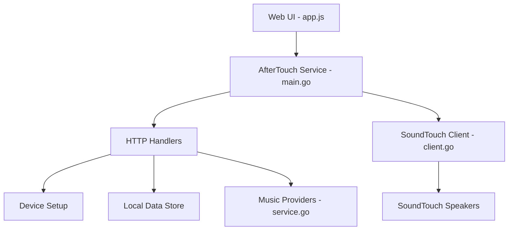

# gesellix/Bose-SoundTouch

> Local server that replaces the discontinued Bose cloud, to keep controlling your SoundTouch speakers.

## The problem
Bose shut down its SoundTouch cloud on 6 May 2026: presets, music service browsing and stereo pairing no longer work through Bose infrastructure.

## What it actually does
AfterTouch is a local server (web interface on `localhost:8000`) that emulates the Bose cloud once the speaker is redirected to it (XML redirect or DNS/DHCP with a home-made CA). The repo also provides `soundtouch-backup` (backup of the account and speakers), `soundtouch-cli`, `soundtouch-player` (LAN web UI) and a Go library `pkg/client`. SSH access to the speakers goes through a `remote_services` USB key.

## How it is wired


## Trying it
```bash
go get github.com/gesellix/bose-soundtouch
soundtouch-backup all
```
The service itself is obtained from the Downloads page, then the web UI guides the configuration.

## Cost and gotchas
Free. It needs a stable address on the local network; DNS redirection requires port 53 and TLS (trust the CA on each speaker). The SSH path and the hosts method are tricky; one hosts method is deprecated.

## What it is not
Not a Bose product nor affiliated with Bose (the README says so). It is not a data/AI tool: it is only useful to people who own SoundTouch speakers. The repo does not redistribute Bose Stockholm code.

## Alternatives
- SoundCork: Python interception service, the origin of the approach.
- SoundTouch Plus: Home Assistant integration.
- STR, SoundTouch Reborn: on-speaker agent plus desktop app.

## For you
Outside the data/AI/MLOps scope: worth watching only if you have Bose SoundTouch speakers to rescue, otherwise of no interest for your profile.
