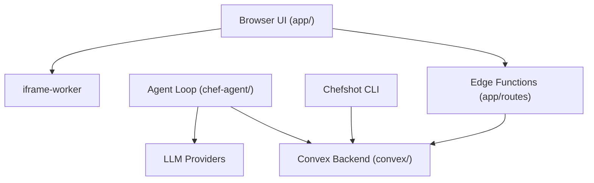

# get-convex/chef

> AI-powered full-stack web app builder, built on the Convex database.

## The problem
An AI app generator often produces a front end without a reliable backend: database, authentication, files and real-time remain to be assembled.

## What it actually does
A web application (fork of bolt.diy) where the `chef-agent` agent writes an application with a Convex database, authentication, file upload, real-time interfaces and background jobs. It calls Anthropic, Google, OpenAI or xAI with your keys. A `chefshot` CLI and a test harness exist.

## How it is wired
Diagram based on the one provided.



## Trying it
```bash
git clone https://github.com/get-convex/chef.git
cd chef
nvm install
nvm use
npm install -g pnpm
pnpm i
echo 'VITE_CONVEX_URL=placeholder' >> .env.local
npx convex dev --once
pnpm run dev
```

## Cost and gotchas
Running locally requires a Convex account, an OAuth application and model keys at your expense. Authentication is tied to Convex's internal control plane: a production fork must replace it. Access via 127.0.0.1, not localhost.

## What it is not
Not a standalone tool: it depends on the Convex infrastructure. The hosted service (free tier) is the normal route; the local install is a sandbox.

## Alternatives
bolt.diy, of which Chef is a fork of the stable branch.

## For you
Worth watching: interesting for prototyping internal tools around your models, but Convex lock-in and keys at your expense suggest testing via the hosted service.
