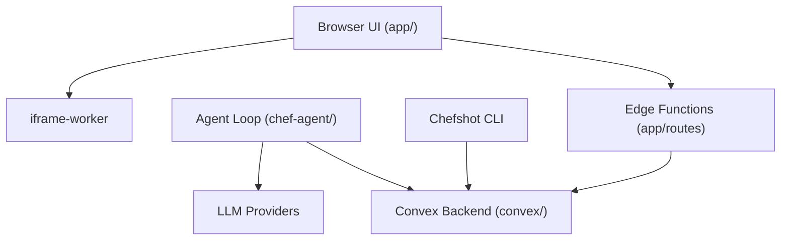

# get-convex/chef

> Constructeur d'applications web full-stack par IA, bâti sur la base de données Convex.

## Le problème
Un générateur d'applications par IA produit souvent du front sans backend fiable : base, authentification, fichiers et temps réel restent à assembler.

## Ce que ça fait vraiment
Une application web (fork de bolt.diy) où l'agent `chef-agent` écrit une application avec base Convex, authentification, envoi de fichiers, interfaces temps réel et tâches de fond. Il appelle Anthropic, Google, OpenAI ou xAI avec tes clés. Une CLI `chefshot` et un harnais de test existent.

## Comment c'est branché
Schéma d'après le diagramme fourni.



## Essayer
```bash
git clone https://github.com/get-convex/chef.git
cd chef
nvm install
nvm use
npm install -g pnpm
pnpm i
echo 'VITE_CONVEX_URL=placeholder' >> .env.local
npx convex dev --once
pnpm run dev
```

## Coût et pièges
Le local exige un compte Convex, une application OAuth et des clés de modèle à ta charge. L'authentification est liée au plan de contrôle interne de Convex : un fork de production doit la remplacer. Accès par 127.0.0.1, pas localhost.

## Ce que ce n'est pas
Pas un outil autonome : il dépend de l'infrastructure Convex. Le service hébergé (palier gratuit) est la voie normale ; l'installation locale est un bac à sable.

## Alternatives
bolt.diy, dont Chef est un fork de la branche stable.

## Pour toi
À surveiller : intéressant pour prototyper des outils internes autour de tes modèles, mais le verrouillage Convex et les clés à ta charge invitent à tester via le service hébergé.

