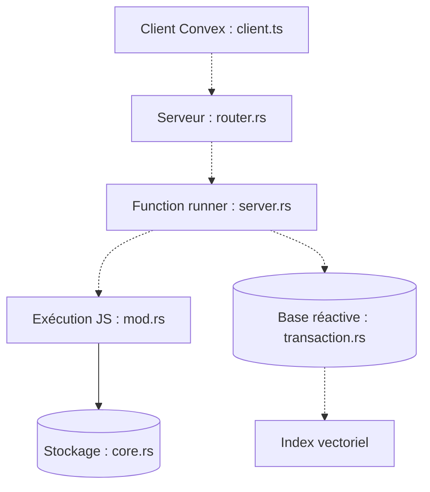

# get-convex/convex-backend

> Open source reactive database where you write server logic in TypeScript, for web application developers.

## The problem
Keeping an interface in sync with consistent data forces you to assemble a database, server functions, a cache and real-time.

## What it actually does
The client subscribes to live queries over WebSocket; the Rust backend runs JavaScript functions against a transactional database. On top of that come file storage, snapshot import/export, text and vector indexes, and a Fivetran connector. Self-hosting via Docker or a prebuilt binary.

## How it is wired


## Trying it
```bash
# Aucune commande documentée dans le README ; voir le guide d'auto-hébergement et BUILD.md.
```

## Cost and gotchas
The cloud has a free tier. When self-hosting, change the default instance secret and admin key. An anonymous beacon (identifier, version, uptime) is sent, and can be disabled with `--disable-beacon`.

## What it is not
Not a classic SQL database. The tests (including the randomized ones) are not provided. Less proven on Windows.

## Alternatives
No alternative cited in the README.

## For you
Worth watching: interesting for demos and real-time apps, but the license is unidentified and there is little link to data work.
